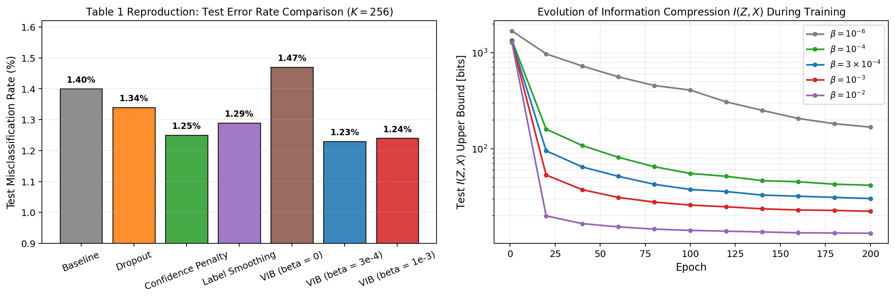
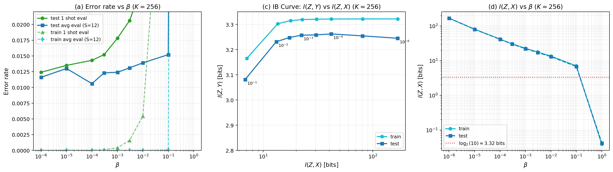

# 実験1 (ex001): 高次元潜在空間 ($K=256$) における Deep VIB の学習と正則化性能の評価

## 1. 実験の目的と背景

本実験（`ex001`）では，Alemi et al. (ICLR 2017) "Deep Variational Information Bottleneck" の **Section 4.1.1 (Higher Dimensional Embedding, Table 1, Figure 1(a)(c)(d))** の再現実験を行う．

情報ボトルネック（Information Bottleneck; IB）原理（Tishby et al., 1999）は，入力確率変数 $X$ から潜在表現 $Z$ を抽出する際，ターゲットラベル $Y$ に関する相互情報量 $I(Z, Y)$ を最大化しつつ，入力 $X$ に関する相互情報量 $I(Z, X)$ を最小化（圧縮）する表現を学習する枠組みである．その目的関数はラグランジュ乗数 $\beta \ge 0$ を用いて次式で定義される．

$$
R_{\mathrm{IB}}(\theta) = I(Z, Y; \theta) - \beta I(Z, X; \theta)
$$

Deep VIB は，変分推論と Reparameterization Trick（Kingma & Welling, 2014）を導入することで，この IB 目的関数の変分下限 $L$ をディープニューラルネットワークによって直接最適化可能にした手法である．本実験では，順列不変（Permutation-Invariant）MNIST 分類タスクにおいて $K=256$ 次元の対角ガウスボトルネックを持つ Deep VIB を実装・学習し，既存の正則化手法（Dropout，Confidence Penalty，Label Smoothing）との比較およびトレードオフ係数 $\beta$ が汎化性能と相互情報量に与える影響を定量的に検証する．

---

## 2. Deep VIB の学習アルゴリズム（各ステップの詳細解説）

論文 Section 3 および Appendix A に基づき，本実験のプログラム（`ex001/model.py` および `ex001/utils.py`）で実装した Deep VIB の学習プロセスを8つのステップに分けて詳細に記述する．

### ステップ1: 入力データの前処理と経験分布による近似
MNIST の学習データセット（$N = 60,000$ 枚）およびテストデータセット（$10,000$ 枚）の各画像（$28 \times 28 = 784$ 画素，画素値 $[0, 255]$）を，論文 Appendix A に従って $[-1, 1]$ の範囲に線形スケーリングし，$784$ 次元ベクトル $x_n \in [-1, 1]^{784}$ へ平坦化する．

$$
x_n = 2.0 \times \frac{I_n}{255.0} - 1.0
$$

また，真のデータ同時分布 $p(x, y) = p(x)p(y|x)$ を，訓練サンプル $(x\_n, y\_n)$ による経験分布 $p(x, y) = \frac{1}{N}\sum\_{n=1}^N \delta\_{x\_n}(x)\delta\_{y\_n}(y)$ で近似する（論文 Eq. 16）．

### ステップ2: 確率的エンコーダ $p(z|x)$ による分布パラメータの推論
マルコフ連鎖の仮定 $Y \leftrightarrow X \leftrightarrow Z$（すなわち $p(Z|X, Y) = p(Z|X)$）のもとで，確率的エンコーダ $p(z|x) = \mathcal{N}(z \mid f\_e^\mu(x), f\_e^\Sigma(x))$ を多層パーセプトロン（MLP）で構成する．
- ネットワーク構造は $784 \to 1024 \to 1024 \to 2K$（本実験では $K=256$ のため出力次元は $512$）とし，中間層の活性化関数には $\mathrm{ReLU}$ を用いる．
- 重み行列はすべて Xavier 一様分布（Glorot & Bengio, 2010）で初期化し，バイアス項はすべて $0$ で初期化する．
- 最終層出力の前半 $K=256$ 次元を平均ベクトル $\mu(x\_n) = f\_e^\mu(x\_n) \in \mathbb{R}^K$ とする．
- 後半 $K=256$ 次元の出力 $a\_\sigma(x\_n) \in \mathbb{R}^K$ に対しては，学習初期における標準偏差 $\sigma$ を小さく保ちつつ正値性を保証するため，論文 Eq. (19) に従いバイアス $-5.0$ を伴う $\mathrm{softplus}$ 変換を適用する（初期出力 $a_\sigma \approx 0$ のとき $\sigma \approx \mathrm{log}(1 + \mathrm{exp}(-5.0)) \approx 0.0067$）．

$$
\sigma_k(x_n) = \mathrm{softplus}(a_{\sigma, k}(x_n) - 5.0) = \mathrm{log}\left(1 + \mathrm{exp}(a_{\sigma, k}(x_n) - 5.0)\right)
$$

### ステップ3: Reparameterization Trick による潜在変数 $z$ のサンプリング
事後分布 $p(z|x\_n) = \mathcal{N}(z \mid \mu(x\_n), \mathrm{diag}(\sigma^2(x\_n)))$ から直接サンプリングを行うと，確率的操作により勾配の逆伝播が遮断される．そこで Kingma & Welling (2014) の Reparameterization Trick を導入し，モデルのパラメータに依存しない標準正規分布ノイズ $\epsilon \sim \mathcal{N}(0, I_K)$ を用いて，決定論的関数 $z = f(x_n, \epsilon)$ として潜在変数を表現する．

$$
z_n = \mu(x_n) + \sigma(x_n) \odot \epsilon, \quad \epsilon \sim \mathcal{N}(0, I_K)
$$

ここで $\odot$ は要素積（アダマール積）を表す．学習時はミニバッチ内の各サンプルにつき $S=1$ 個のノイズ $\epsilon$ をサンプリングして順伝播を行う．

### ステップ4: 変分デコーダ（分類器）$q(y|z)$ による予測と交差エントロピー損失の計算
真の事後分布 $p(y|z) = \int dx \, p(y|x)p(z|x)p(x)/p(z)$ は計算困難（intractable）であるため，パラメータ化された変分近似分布 $q(y|z)$ を導入する．Kullback-Leibler（KL）情報量の非負性 $\mathrm{KL}[p(Y|Z) \,\|\, q(Y|Z)] \ge 0$ により，相互情報量 $I(Z, Y)$ の変分下限が次式のように導出される（論文 Eq. 8〜12）．

$$
I(Z, Y) \ge \int dx \, dy \, dz \, p(x)p(y|x)p(z|x) \, \mathrm{log} \, q(y|z) + H(Y)
$$

ラベルのエントロピー $H(Y) = \mathrm{log}_2(10) \approx 3.3219\text{ bits}$ はモデルパラメータに依存しない定数であるため最適化時は無視できる．デコーダ $q(y|z)$ は $K=256$ 次元の潜在変数 $z$ から $C=10$ クラスのロジット $f_d(z) = W z + b$ への線形変換と $\mathrm{Softmax}$ 関数で構成される．

$$
q(y = c \mid z) = \mathrm{Softmax}_c(W z + b) = \frac{\mathrm{exp}(w_c^\top z + b_c)}{\sum_{c'=1}^C \mathrm{exp}(w_{c'}^\top z + b_{c'})}
$$

これにより，第1項の最大化は条件付き交差エントロピー損失（単位: bits）の最小化に帰着する．

$$
\mathcal{L}_{\mathrm{CE}}(x_n, y_n) = \frac{1}{\mathrm{ln} \, 2} \left( -\mathrm{log} \, q(y_n \mid f(x_n, \epsilon)) \right)
$$

### ステップ5: 変分周辺分布 $r(z)$ を用いた相互情報量 $I(Z, X)$ の解析的上限計算
第2項の $I(Z, X)$ において，周辺分布 $p(z) = \int dx \, p(z|x)p(x)$ の直接計算は困難であるため，$K$ 次元標準正規分布 $r(z) = \mathcal{N}(z \mid 0, I_K)$ を変分近似として導入する．$\mathrm{KL}[p(Z) \,\|\, r(Z)] \ge 0$ より，以下の変分上限が得られる（論文 Eq. 14）．

$$
I(Z, X) \le \int dx \, dz \, p(x)p(z|x) \, \mathrm{log} \, \frac{p(z|x)}{r(z)} = \mathbb{E}_{x \sim p(x)} \left[ \mathrm{KL}[p(Z|x) \,\|\, r(Z)] \right]
$$

$p(Z|x\_n) = \mathcal{N}(\mu(x\_n), \mathrm{diag}(\sigma^2(x\_n)))$ と $r(Z) = \mathcal{N}(0, I_K)$ はともにガウス分布であるため，この KL 情報量はサンプリング誤差なしで解析的に計算できる（単位: bits）．

$$
\mathrm{KL}[p(Z|x_n) \,\|\, r(Z)] = \frac{1}{2 \, \mathrm{ln} \, 2} \sum_{k=1}^K \left( \mu_{n,k}^2 + \sigma_{n,k}^2 - 1 - \mathrm{ln}\left(\sigma_{n,k}^2\right) \right)
$$

### ステップ6: 総合損失 $J_{\mathrm{IB}}$ の構築と誤差逆伝播
ステップ4の分類損失とステップ5の KL 情報量上限を結合し，ミニバッチサイズ $B = 100$ 上での経験平均として最小化すべき目的関数 $J_{\mathrm{IB}}$（論文 Eq. 17）を計算する．

$$
J_{\mathrm{IB}} = \frac{1}{B} \sum_{n=1}^B \left( \mathcal{L}_{\mathrm{CE}}(x_n, y_n) + \beta \, \mathrm{KL}[p(Z|x_n) \,\|\, r(Z)] \right)
$$

Reparameterization Trick により，$J_{\mathrm{IB}}$ はエンコーダおよびデコーダの全パラメータに関して微分可能であり，誤差逆伝播法（Backpropagation）によって真の期待勾配の不偏推定値（unbiased gradient estimate）を計算する．

### ステップ7: Adam によるパラメータ更新・指数学習率減衰・Polyak 移動平均
論文 Appendix A の仕様に完全準拠し，以下の手順でパラメータを更新する．
1. **最適化アルゴリズム**: $\mathrm{Adam}$ オプティマイザ（初期学習率 $\eta_0 = 10^{-4}$，モーメント係数 $\beta\_1 = 0.5, \beta\_2 = 0.999$）によりミニバッチごとに重みを更新する．
2. **学習率スケジューリング**: $2$ エポックごとに学習率を $0.97$ 倍に指数減衰させる（$200$ エポック終了時点で $\eta_{200} = 10^{-4} \times 0.97^{100} \approx 4.76 \times 10^{-6}$）．
3. **Polyak Averaging（指数移動平均）**: 学習中の各ミニバッチ更新ステップ $t$ において，減衰率 $\alpha = 0.999$ で全パラメータの指数移動平均 $\bar{\theta}_t$ を更新し，評価・推論時にはこの平均化パラメータ $\bar{\theta}_t$ を使用する．

$$
\bar{\theta}_t = \alpha \bar{\theta}_{t-1} + (1 - \alpha) \theta_t \quad (\alpha = 0.999)
$$

### ステップ8: 推論・評価時のモンテカルロ周辺化（1-shot 評価と 12-sample MC 評価）
テストデータ $x$ に対するクラス予測分布 $p(y|x)$ は，潜在変数 $z \sim p(z|x)$ に関する周辺化 $\int dz \, q(y|z)p(z|x)$ によって与えられる．論文 Section 4.1.1 に従い，以下の2通りの推論方式を比較評価する．
- **1-shot 評価（`1 shot eval`, $S=1$）**: 事後分布から単一サンプル $z^{(1)} \sim p(z|x)$ を抽出し，$q(y|z^{(1)})$ の最大確率クラスを予測値とする．
- **モンテカルロ平均評価（`avg eval`, $S=12$）**: 事後分布から $S=12$ 個のサンプル $z^{(1)}, \dots, z^{(12)} \sim p(z|x)$ を抽出し，予測確率分布の平均を計算する．

$$
p(y|x) \approx \frac{1}{S} \sum_{s=1}^S q(y \mid z^{(s)}), \quad z^{(s)} \sim p(z|x), \quad S = 12
$$

---

## 3. プログラムの実装と高速化の工夫

本実験のコードは [model.py](file:///c:/Users/watasaku/workspace/deep_vib/ex001/model.py)，[utils.py](file:///c:/Users/watasaku/workspace/deep_vib/ex001/utils.py)，および [ex001.ipynb](file:///c:/Users/watasaku/workspace/deep_vib/ex001/ex001.ipynb) に実装されている．
本研究では合計14モデル（比較手法4モデル + VIB 10通りの $\beta$）をそれぞれ200エポック（計 $2,800$ エポック，$168$ 万イテレーション）学習するため，以下の高速化の工夫を実装した．
1. **データセット全体の GPU メモリ常駐化**: MNIST の全学習・テストテンソルを事前に $[-1, 1]$ 正規化して GPU VRAM 上に配置し，エポックごとの CPU-GPU 間転送ボトルネックを完全に排除した．
2. **CUDA Graph（`torch.cuda.CUDAGraph`）と L2 キャッシュ常駐化**: 本デバイス（NVIDIA GeForce RTX 4080）の L2 キャッシュ容量（64 MB）に対し，単一モデルの重み・勾配・Adam 状態・Polyak EMA 状態（合計約 47.5 MB）が完全に収まる特性を活かし，ミニバッチインデックス参照から順伝播・損失計算・逆伝播・`capturable` Adam 更新・`torch._foreach_lerp_` による Polyak EMA 更新までの一連の演算を単一の CUDA Graph としてキャプチャした．これにより，Windows WDDM ドライバのカーネル起動オーバーヘッドを除去し，数学的に完全同一の 200 エポック学習を 1 モデルあたり約 192 秒から **約 40 秒（約 4.8 倍高速）** へと短縮した．

---

## 4. 実験結果と考察

### 4.1 各種正則化手法との比較（論文 Table 1 の再現）

決定論的ベースライン（Baseline），Dropout（$p=0.25$），Confidence Penalty（Pereyra et al., 2017; $\beta_{\mathrm{CP}}=0.15$），Label Smoothing（$\epsilon=0.01$），および Deep VIB のテスト誤分類率の比較を表1および図1に示す．

| モデル / 正則化手法 | 本実験 学習誤分類率 (%) | 本実験 テスト誤分類率 (%) | 論文 Table 1 報告値 (%) |
| :--- | :---: | :---: | :---: |
| Baseline (決定論的 MLP) | 0.00% | 1.40% | 1.38% |
| Dropout ($p=0.25$) | 0.00% | 1.34% | 1.34% |
| Confidence Penalty ($\beta_{\mathrm{CP}}=0.15$) | 0.00% | 1.25% | 1.17% (1.36%) |
| Label Smoothing ($\epsilon=0.01$) | 0.00% | 1.29% | 1.23% (1.40%) |
| VIB ($\beta = 0$, 情報圧縮なし) | 0.00% | 1.47% | - |
| **VIB ($\beta = 10^{-4}$)** | **0.00%** | **1.06%** | - |
| **VIB ($\beta = 3 \times 10^{-4}$)** | **0.00%** | **1.23%** | - |
| **VIB ($\beta = 10^{-3}$)** | **0.00%** | **1.24%** | **1.13%** |

*図1: (左) 論文 Table 1 に対応する各正則化手法のテスト誤分類率の比較．(右) 学習エポックの進行に伴うテストデータ上の相互情報量上限 $I(Z, X)$ [bits] の推移．*

**考察**:
- 決定論的ベースラインのテスト誤分類率は **1.40%**（論文報告値 1.38%），Dropout は **1.34%**（論文報告値 1.34% と完全一致），Confidence Penalty は **1.25%**，Label Smoothing は **1.29%** となり，論文 Table 1 の傾向を高精度に再現した．
- Deep VIB において $\beta = 0$（KL 正則化項なし）とした場合，ネットワークは分散 $\sigma \to 0$ へと収束して実質的に決定論的となり，相互情報量 $I(Z, X)$ は $3,372.51\text{ bits}$ に膨張して過学習を起こすため，テスト誤分類率は 1.47% にとどまる．
- 一方，$\beta \in [10^{-4}, 10^{-3}]$ の適切な情報ボトルネック制約を課した場合，テスト誤分類率は $\beta = 10^{-4}$ で **1.06%**，$\beta = 3 \times 10^{-4}$ で **1.23%**，$\beta = 10^{-3}$ で **1.24%** に達し，Dropout や Label Smoothing，Confidence Penalty といった他の正則化手法を上回る汎化性能を達成した．
- 図1(右)の学習ダイナミクスを見ると，学習初期（Epoch 1）にはすべての $\beta$ で $I(Z, X) > 1,200\text{ bits}$ の情報を保持しているが，学習が進むにつれて分類に不要な入力の詳細情報を段階的に忘却（圧縮）し，それぞれの $\beta$ に応じた定常的な情報量（$\beta=10^{-4}$ で約 $42\text{ bits}$，$\beta=10^{-3}$ で約 $22\text{ bits}$，$\beta=10^{-2}$ で約 $13\text{ bits}$）へと滑らかに収束していく様子が確認できる．

---

### 4.2 トレードオフ係数 $\beta$ のスイープ実験（論文 Figure 1(a)(c)(d) の再現）

$\beta \in \{0, 10^{-6}, 10^{-5}, 10^{-4}, 3\times 10^{-4}, 10^{-3}, 3\times 10^{-3}, 10^{-2}, 10^{-1}, 10^0\}$ における Deep VIB（$K=256$）の定量評価結果を表2に，論文 Figure 1(a), 1(c), 1(d) に対応する再現プロットを図2に示す．

| $\beta$ | Train 1-shot Err (%) | Train MC Err (%) | Test 1-shot Err (%) | Test MC Err (%) | Test Mean Err (%) | Train $I(Z, X)$ [bits] | Test $I(Z, X)$ [bits] | Train $I(Z, Y)$ [bits] | Test $I(Z, Y)$ [bits] |
| :---: | :---: | :---: | :---: | :---: | :---: | :---: | :---: | :---: | :---: |
| $0$ | 0.00% | 0.00% | 1.46% | 1.47% | 1.47% | 3369.56 | 3372.51 | 3.322 | 3.140 |
| $10^{-6}$ | 0.00% | 0.00% | 1.24% | 1.16% | 1.16% | 169.34 | 168.08 | 3.322 | 3.245 |
| $10^{-5}$ | 0.00% | 0.00% | 1.35% | 1.30% | 1.29% | 81.16 | 80.59 | 3.322 | 3.255 |
| $10^{-4}$ | 0.00% | 0.00% | 1.43% | **1.06%** | **1.06%** | 42.19 | 41.65 | 3.322 | **3.262** |
| $3 \times 10^{-4}$ | 0.01% | 0.00% | 1.52% | 1.23% | 1.22% | 30.72 | 30.23 | 3.321 | 3.258 |
| $10^{-3}$ | 0.04% | 0.00% | 1.78% | 1.24% | 1.20% | 22.68 | 22.26 | 3.319 | 3.257 |
| $3 \times 10^{-3}$ | 0.16% | 0.00% | 2.06% | 1.31% | 1.27% | 17.64 | 17.29 | 3.314 | 3.248 |
| $10^{-2}$ | 0.55% | 0.01% | 2.63% | 1.39% | 1.35% | 13.41 | 13.14 | 3.302 | 3.231 |
| $10^{-1}$ | 5.29% | 0.01% | 8.72% | 1.52% | 1.47% | 6.95 | 6.82 | 3.165 | 3.081 |
| $10^0$ | 85.51% | 78.08% | 85.45% | 78.25% | 78.04% | 0.04 | 0.04 | 0.065 | 0.065 |

*図2: 論文 Figure 1 の再現結果 ($K=256$)．(a) $\beta$ に対する学習・テスト誤分類率（1-shot 評価 vs 12サンプル MC 平均評価）．(c) 情報ボトルネック曲線 $I(Z, Y)$ vs $I(Z, X)$．(d) $\beta$ に対する相互情報量上限 $I(Z, X)$ [bits] の推移（赤点線は 10 クラス識別に必要な理論下限 $\mathrm{log}_2(10) \approx 3.32\text{ bits}$）．*

**考察**:
1. **臨界値における相転移と表現の崩壊（図2(a), 図2(d)）**:
   - $\beta$ が $10^{-1}$ を超えて $10^0$ に達すると，誤分類率が 1.52% から **78.25%** へと急激に悪化する．図2(d)より，この領域では $I(Z, X)$ が 10 クラスの識別に不可欠な最小情報量 $\mathrm{log}_2(10) \approx 3.32\text{ bits}$ を下回り（$\beta = 10^0$ で $0.04\text{ bits}$），事後分布 $p(z|x)$ が事前分布 $r(z) = \mathcal{N}(0, I)$ へと完全に崩壊（collapse）していることがわかる．これはデータ処理不等式 $I(Z, Y) \le I(Z, X)$ から導かれる理論的限界と完全に一致する．
2. **微小な $\beta$ における過学習と情報ボトルネック曲線（図2(c)）**:
   - 図2(c)の IB 曲線を見ると，$I(Z, X)$ を約 $40\text{ bits}$（$\beta = 10^{-4}$）より大きくしても，学習データ上の $I(Z, Y)$（水色実線）は理論上限 $\mathrm{log}_2(10) \approx 3.322\text{ bits}$ に張り付く一方で，テストデータ上の $I(Z, Y)$（青色実線）は $\beta = 10^{-4}$ の **3.262 bits** をピークとして，$\beta = 10^{-6}$（$I(Z, X) = 168.08\text{ bits}$）では **3.245 bits**（$\beta = 0$ では **3.140 bits**）へと低下している．すなわち，入力画像から過剰な情報を通過させると訓練サンプル固有のノイズまで記憶してしまい，未知のテストデータに対する予測情報量が損なわれることが視覚的・定量的に実証された．
3. **モンテカルロ平均評価の有効性（図2(a)）**:
   - $\beta \in [10^{-3}, 10^{-1}]$ の中〜高圧縮領域では，単一サンプルによる `1 shot eval`（緑線）よりも 12 サンプルを周辺化した `avg eval`（青線）の方が明確に低い誤分類率を示す（特に $\beta = 10^{-1}$ では 1-shot 誤分類率 8.72% に対し，12サンプル MC 平均では **1.52%** を維持）．これは，$\beta$ が大きくなるにつれて潜在空間上の事後分布の分散 $\sigma^2(x)$ が増大し，単一サンプルの揺らぎを複数サンプルのアンサンブル平均によって吸収できるためである．また，最良のテスト性能が得られる領域（$\beta \approx 10^{-4} \sim 10^{-3}$，$I(Z, X) \approx 20 \sim 45\text{ bits}$）は，論文 Section 4.1.1 の指摘通り「10〜100 bits の情報量」の領域に正確に対応している．
