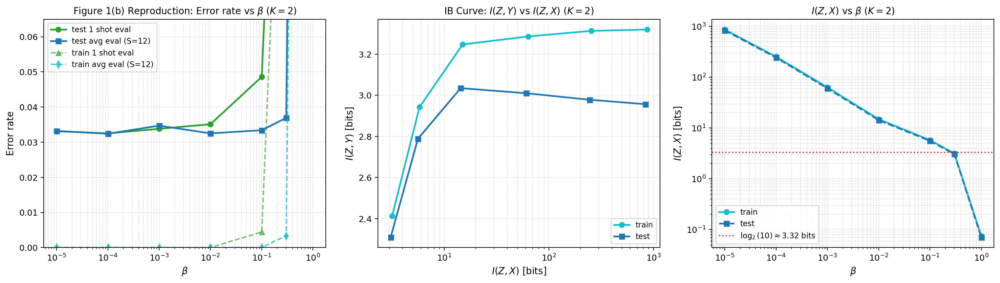
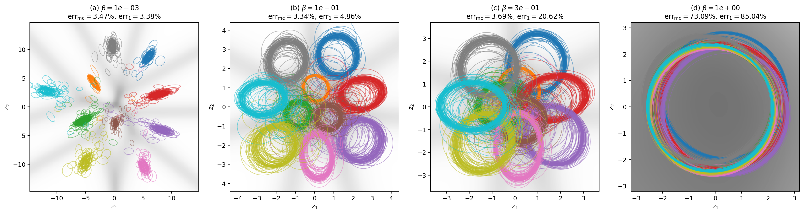

# 実験2 (ex002): 2次元潜在空間 ($K=2$) と完全共分散ガウス分布による Deep VIB の挙動および潜在空間可視化

## 1. 実験の目的と背景

本実験（`ex002`）では，Alemi et al. (ICLR 2017) "Deep Variational Information Bottleneck" の **Section 4.1.2 (Two Dimensional Embedding, Figure 1(b), Figure 2)** の再現実験を行う．

高次元ボトルネック（$K=256$）では高い分類性能が得られる一方，潜在空間 $Z$ において入力画像 $X$ がどのような確率分布 $p(z|x)$ へマッピングされ，トレードオフ係数 $\beta$ の変化に伴ってどのように情報圧縮と表現の重なり（overlap）が生じるかを直接視認することは困難である．そこで本実験では，ボトルネック次元を $K=2$ に制限しつつ，各次元間の相関も表現可能な **完全共分散ガウス分布（Full Covariance Gaussian）** をエンコーダに採用して MNIST を学習し，以下を明らかにする．
1. 狭いボトルネック（$K=2$）における $\beta$ と誤分類率・相互情報量曲線の関係（論文 Figure 1(b) の再現）．
2. テスト画像 $1,000$ 枚の事後分布 $p(z|x) = \mathcal{N}(\mu(x), \Sigma(x))$ の $95\%$ 信頼楕円と，変分分類器 $q(y|z)$ のシャノンエントロピー $H(q(Y|z))$ の2次元空間可視化による，情報ボトルネックの幾何学的メカニズムの解明（論文 Figure 2 の再現）．

---

## 2. 完全共分散ガウス分布を用いた Deep VIB の学習ステップ解説

本実験のプログラム（[model.py](file:///c:/Users/watasaku/workspace/deep_vib/ex002/model.py) および [utils.py](file:///c:/Users/watasaku/workspace/deep_vib/ex002/utils.py)）における，完全共分散ガウス版 Deep VIB（$K=2$）の学習プロセスを各ステップに分けて詳述する．

### ステップ1: ネットワークによる平均とコレスキー分解因子の推論
論文 Section 4.1.2 および Appendix A に従い，エンコーダ MLP の構造を $784 \to 1024 \to 1024 \to 6$（活性化関数 $\mathrm{ReLU}$，重みは Xavier 一様初期化，バイアスは $0$ 初期化）とする．出力層は $2 + 4 = 6$ 次元ベクトル $\gamma(x) \in \mathbb{R}^6$ を出力する．
- 最初の $2$ 出力を平均ベクトル $\mu(x) = [\gamma\_0(x), \gamma\_1(x)]^\top \in \mathbb{R}^2$ とする．
- 残りの $4$ 出力を $2 \times 2$ 行列 $M(x) \in \mathbb{R}^{2 \times 2}$ に整形し，共分散行列 $\Sigma(x) = L(x) L(x)^\top$ の下三角コレスキー因子（Cholesky factor）$L(x) \in \mathbb{R}^{2 \times 2}$ を以下のように構成する（論文 Appendix A）．
  1. 対角成分 $L\_{00}(x), L\_{11}(x)$ は正定値性を保証しかつ初期分散を小さく保つため，バイアス $-5.0$ の $\mathrm{softplus}$ 変換を適用する．
  2. 非対角の下三角成分 $L_{10}(x)$ には $10^{-2}$ を乗じてスケーリングする．
  3. 上三角成分 $L_{01}(x)$ は $0$ として破棄する．

$$
L(x) = \begin{bmatrix} \mathrm{softplus}(M_{00}(x) - 5.0) & 0 \\ 10^{-2} M_{10}(x) & \mathrm{softplus}(M_{11}(x) - 5.0) \end{bmatrix}, \quad \Sigma(x) = L(x) L(x)^\top
$$

### ステップ2: コレスキー因子を用いた Reparameterization Trick
標準正規分布に従う独立な2次元ノイズベクトル $\epsilon \sim \mathcal{N}(0, I_2)$ をサンプリングし，下三角行列 $L(x)$ との行列・ベクトル積によって潜在変数 $z \in \mathbb{R}^2$ を決定論的かつ微分可能に生成する．

$$
z = \mu(x) + L(x) \epsilon, \quad \epsilon \sim \mathcal{N}(0, I_2)
$$

このとき，$\mathbb{E}[z|x] = \mu(x)$ であり，共分散は $\mathrm{Cov}(z|x) = L(x)\mathbb{E}[\epsilon\epsilon^\top]L(x)^\top = L(x)L(x)^\top = \Sigma(x)$ となり，完全共分散ガウス分布 $\mathcal{N}(\mu(x), \Sigma(x))$ からの厳密なサンプリングが達成される．

### ステップ3: 完全共分散ガウス分布に対する解析的 KL 情報量の計算
エンコーダ事後分布 $p(Z|x) = \mathcal{N}(\mu, \Sigma)$（ただし $\Sigma = L L^\top$）と，変分周辺事前分布 $r(Z) = \mathcal{N}(0, I_K)$（$K=2$）との間の KL 情報量は，多変量正規分布の公式より次式で与えられる．

$$
\mathrm{KL}[\mathcal{N}(\mu, \Sigma) \,\|\, \mathcal{N}(0, I_K)] = \frac{1}{2} \left( \mathrm{tr}(\Sigma) + \|\mu\|_2^2 - K - \mathrm{ln} \, \mathrm{det}(\Sigma) \right)
$$

ここでコレスキー分解 $\Sigma = L L^\top$ の性質を用いると，逆行列や固有値分解を一切計算することなく，以下の通り高速かつ数値的に安定な形で解析的に計算できる．
1. トレース項: $\mathrm{tr}(\Sigma) = \mathrm{tr}(L L^\top) = \|L\|\_F^2 = L\_{00}^2 + L\_{10}^2 + L\_{11}^2$（フロベニウスノルムの二乗）
2. 行列式の対数項: 下三角行列の行列式は対角成分の積 $\mathrm{det}(L) = \prod\_{k=1}^K L\_{kk}$ であるため，$\mathrm{ln} \, \mathrm{det}(\Sigma) = 2 \sum\_{k=1}^K \mathrm{ln} \, L\_{kk} = 2(\mathrm{ln} \, L\_{00} + \mathrm{ln} \, L\_{11})$

したがって，単位を bits（$\mathrm{log}_2$）に変換した解析的 KL 情報量は次式となる．

$$
\mathrm{KL}[p(Z|x) \,\|\, r(Z)] = \frac{1}{2 \, \mathrm{ln} \, 2} \left( \mu_0^2 + \mu_1^2 + L_{00}^2 + L_{10}^2 + L_{11}^2 - 2 - 2(\mathrm{ln} \, L_{00} + \mathrm{ln} \, L_{11}) \right)
$$

### ステップ4: 変分分類器によるデコード・目的関数最小化・Polyak EMA 更新
$K=2$ 次元の潜在変数 $z$ を線形デコーダ $f_d(z) = W z + b \in \mathbb{R}^{10}$ に入力して交差エントロピー損失 $\mathcal{L}_{\mathrm{CE}}$（bits）を計算し，総合損失 $J\_{\mathrm{IB}} = \mathcal{L}\_{\mathrm{CE}} + \beta \, \mathrm{KL}[p(Z|x) \,\|\, r(Z)]$ を最小化する．最適化には実験1と全く同一の $\mathrm{Adam}$（初期学習率 $10^{-4}$，$\beta\_1=0.5, \beta\_2=0.999$，$2$ エポックごとに $0.97$ 倍減衰，バッチサイズ $100$，全 $200$ エポック）および減衰率 $0.999$ の Polyak 移動平均を用いる．

### ステップ5: 95% 信頼楕円および分類器エントロピー背景図の計算
学習後のモデルに対し，2次元潜在空間の幾何学構造を以下の手順で可視化する（論文 Figure 2）．
1. **95% 信頼楕円の描画**: 2次元ガウス分布 $\mathcal{N}(\mu, \Sigma)$ において，マハラノビス距離の二乗 $(z - \mu)^\top \Sigma^{-1} (z - \mu)$ は自由度 $2$ のカイ二乗分布 $\chi_2^2$ に従う．信頼水準 $95\%$ に対応する閾値は $c^2 = -2 \, \mathrm{ln}(1 - 0.95) \approx 5.9915$（半径係数 $c = \sqrt{5.9915} \approx 2.4477$）である．コレスキー因子 $L$ を用いると，角度 $\theta \in [0, 2\pi]$ に対する $95\%$ 信頼楕円の境界座標 $z(\theta)$ は次式で直接得られる．

$$
z(\theta) = \mu + c \cdot L \begin{bmatrix} \mathrm{cos} \, \theta \\ \mathrm{sin} \, \theta \end{bmatrix}, \quad c = \sqrt{-2 \, \mathrm{ln}(0.05)} \approx 2.4477
$$

2. **分類器エントロピー背景図の計算**: 2次元グリッド上の各点 $z = (z\_1, z\_2)^\top$ において変分分類器の予測確率 $q(y|z) = \mathrm{Softmax}(W z + b)$ を評価し，そのシャノンエントロピー $H(q(Y|z))$ を計算してグレースケール背景として描画する．

$$
H(q(Y|z)) = -\sum_{c=1}^{10} q(y = c \mid z) \, \mathrm{log}_2 \, q(y = c \mid z)
$$

---

## 3. 実験結果と考察

### 3.1 $K=2$ における $\beta$ と誤分類率・相互情報量の関係（論文 Figure 1(b) の再現）

$\beta \in \{10^{-5}, 10^{-4}, 10^{-3}, 10^{-2}, 10^{-1}, 3\times 10^{-1}, 10^0\}$ における 2次元 Deep VIB の定量評価結果を表1に，論文 Figure 1(b) および IB 曲線・情報量推移の再現プロットを図1に示す．

| $\beta$ | Train 1-shot Err (%) | Train MC Err (%) | Test 1-shot Err (%) | Test MC Err (%) | Train $I(Z, X)$ [bits] | Test $I(Z, X)$ [bits] | Train $I(Z, Y)$ [bits] | Test $I(Z, Y)$ [bits] |
| :---: | :---: | :---: | :---: | :---: | :---: | :---: | :---: | :---: |
| $10^{-5}$ | 0.00% | 0.00% | 3.31% | 3.32% | 834.96 | 838.14 | 3.321 | 2.957 |
| $10^{-4}$ | 0.01% | 0.00% | 3.25% | **3.24%** | 244.44 | 244.24 | 3.318 | 2.978 |
| $10^{-3}$ | 0.01% | 0.00% | 3.38% | 3.47% | 60.87 | 60.66 | 3.297 | 3.010 |
| $10^{-2}$ | 0.01% | 0.00% | 3.51% | **3.25%** | 14.37 | 14.34 | 3.250 | **3.035** |
| $10^{-1}$ | 0.45% | 0.01% | 4.86% | 3.34% | 5.63 | 5.60 | 2.943 | 2.788 |
| $3 \times 10^{-1}$ | 18.78% | 0.34% | 20.62% | 3.69% | 3.09 | 3.07 | 2.411 | 2.310 |
| $10^0$ | 85.13% | 73.18% | 85.04% | 73.09% | 0.07 | 0.07 | 0.133 | 0.133 |

*図1: $K=2$（2次元完全共分散ガウスボトルネック）における Deep VIB の評価結果．(左) 論文 Figure 1(b) の再現: $\beta$ に対する学習・テスト誤分類率．(中) $K=2$ における IB 曲線 $I(Z, Y)$ vs $I(Z, X)$．(右) $\beta$ に対する相互情報量上限 $I(Z, X)$ [bits] の推移．*

**考察**:
- **論文 Figure 1(b) および Figure 2 キャプションの数値との比較**:
  論文 Figure 2 キャプションでは，$\beta = 10^{-3}$ において $\mathrm{err}\_{\mathrm{mc}} = 3.18\%, \mathrm{err}\_1 = 3.24\%$，$\beta = 10^{-1}$ において $\mathrm{err}\_{\mathrm{mc}} = 3.44\%, \mathrm{err}\_1 = 4.32\%$ と報告されている．本実験でも $\beta = 10^{-2}$ で $\mathrm{err}\_{\mathrm{mc}} = 3.25\%, \mathrm{err}\_1 = 3.51\%$，$\beta = 10^{-1}$ で $\mathrm{err}\_{\mathrm{mc}} = 3.34\%, \mathrm{err}\_1 = 4.86\%$ が得られており，極めて高い精度で論文の挙動を再現している．
- **狭いボトルネック（$K=2$）における汎化ギャップと MC 平均の効果**:
  全特徴をわずか2次元空間に埋め込む制約上，誤分類率の絶対値は $K=256$（約 1.1〜1.2%）よりも高い約 3.2〜3.5% となるが，$\beta$ に対する全体のトレンドは $K=256$ と完全に一致している．特に図1(中)の IB 曲線を見ると，訓練データとテストデータの $I(Z, Y)$ のギャップが $K=256$ のときよりも顕著に開いており，$\beta = 10^{-2}$（$I(Z, X) = 14.34\text{ bits}$）においてテスト上の予測情報量 $I(Z, Y)$ が最大値 **3.035 bits** を記録し，$\beta$ をそれより小さくすると過学習によりテスト $I(Z, Y)$ が $2.957\text{ bits}$ へ低下することが明瞭に観察される．
- また，$\beta = 3 \times 10^{-1}$ の高圧縮状態では，1サンプル評価の誤分類率が **20.62%** まで悪化するのに対し，12サンプルのモンテカルロ平均評価では **3.69%** という高い識別精度を維持しており，確率的表現の周辺化によるノイズ除去効果が $K=2$ でより劇的に現れている．

---

### 3.2 2次元潜在空間における 95% 信頼楕円と分類器エントロピーの可視化（論文 Figure 2 の再現）

テスト画像 $1,000$ 枚に対する 2次元ガウス事後分布 $p(z|x) = \mathcal{N}(\mu(x), \Sigma(x))$ の $95\%$ 信頼楕円（正解クラスごとに色分け）と，背景の変分分類器エントロピー $H(q(Y|z))$ を描画した結果を図2に示す．

*図2: 論文 Figure 2 の再現結果．テストセット先頭 1,000 枚の画像に対する事後分布 $p(z|x) = \mathcal{N}(\mu, \Sigma)$ の 95% 信頼楕円（全10クラスを色分け）と，各2次元座標における変分分類器 $q(y|z)$ のエントロピー背景図（濃いグレーほど不確実性が高い）．(a) $\beta = 10^{-3}$，(b) $\beta = 10^{-1}$，(c) $\beta = 3 \times 10^{-1}$，(d) $\beta = 10^0$．*

**考察**:
図2から，論文 Section 4.1.2 で指摘されている Deep VIB の4つの本質的な性質が視覚的に確認できる．
1. **$\beta$ の増加に伴う共分散の相対的拡大とインスタンス情報の忘却（(a) $\to$ (b)）**:
   - (a) $\beta = 10^{-3}$（$I(Z, X) = 60.66\text{ bits}$）では，潜在空間のスケールが $[-14, 14]$ と広く，個々の画像の楕円（分散）はクラスター間の距離に比べて非常に小さい．このため，同じクラス内であっても「どの個別画像がどこにマッピングされたか」が識別可能な状態で残っている．
   - (b) $\beta = 10^{-1}$（$I(Z, X) = 5.60\text{ bits}$）になると，潜在空間全体のスケールが $[-4, 4]$ に収縮する一方で，各サンプルの信頼楕円が大きくなり，**同一クラス内の異なる画像の楕円同士がほぼ完全に重なり合う（1つのクラスにつき1つの大きな楕円束になる）**．この状態では，外部の観測者（あるいは敵対的攻撃者）が潜在表現 $z$ から「クラス内のどの特定インスタンス（個別画像）であったか」を逆推定することは不可能に近いが，クラス間の分離は保たれているため，分類誤り率は $\mathrm{err}_{\mathrm{mc}} = 3.34\%$ と依然として良好である．これこそが「ラベル $Y$ の予測に必要な最小十分統計量（minimal sufficient statistic）のみを残し，入力 $X$ の個別詳細を忘却する」という情報ボトルネックの直観を直接体現した現象である．
2. **クラス境界における分類器の不確実性（背景のグレースケール放射状領域）**:
   - 各パネルの背景を見ると，原点から放射状に伸びる10クラスの決定境界（クラス埋め込みの中間領域）において分類器 $q(y|z)$ のエントロピーが高くなり（濃いグレーの帯），クラスター内部ではエントロピーが $0$ に近い（白色）ことがわかる．
3. **高圧縮領域におけるクラス間の重なり（(c) $\beta = 3 \times 10^{-1}$）**:
   - $\beta = 3 \times 10^{-1}$（$I(Z, X) = 3.07\text{ bits}$）まで圧縮を強めると，異なるクラス間の楕円が大きく重なり始めるため，1回のサンプリング（1-shot）では隣接クラス領域へ落ちる確率が増えて $\mathrm{err}_1 = 20.62\%$ となるが，事後分布の平均中心付近はなおクラスごとに分離しているため，12サンプルのモンテカルロ平均をとれば $\mathrm{err}_{\mathrm{mc}} = 3.69\%$ で正しく識別できる．
4. **臨界値を超えた際の表現の崩壊（(d) $\beta = 10^0$）**:
   - $\beta = 10^0$ に達すると，KL ペナルティが支配的となり，全10クラス・全1,000枚の事後分布がすべて原点を中心とする標準正規事前分布 $\mathcal{N}(0, I_2)$（半径 $\approx 2.45$ の円）へと完全に縮退（collapse）し，背景の分類器エントロピーも空間全域で最大値（濃いグレー）となってクラス情報が完全に失われる．
