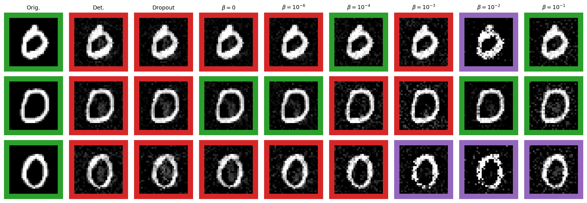
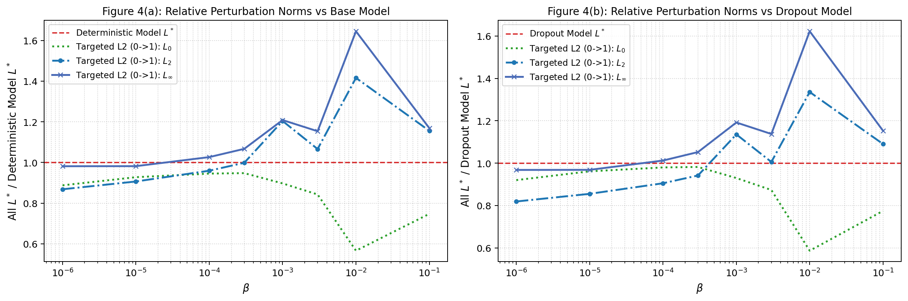
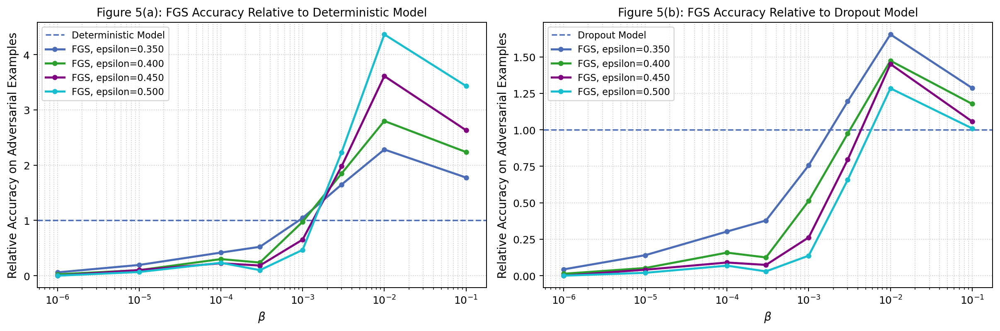
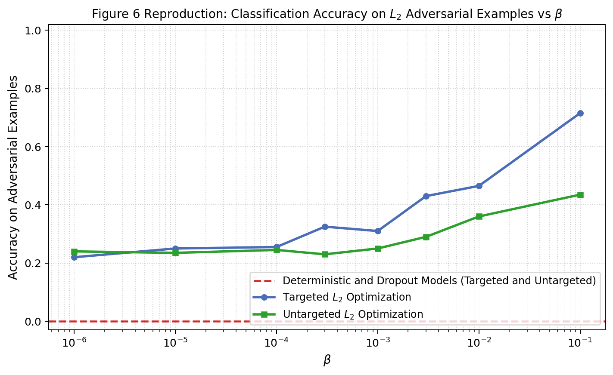

# 実験3 (ex003): 敵対的サンプル (Adversarial Examples) に対する Deep VIB の頑健性評価

## 1. 実験の目的と背景

本実験（`ex003`）では，Alemi et al. (ICLR 2017) "Deep Variational Information Bottleneck" の **Section 4.2 (Behavior on Adversarial Examples, Figures 3, 4, 5, 6)** および **Appendix C (Quadratic Bounds for Stochastic Logistic Regression Decoder)** の再現実験を行う．

Szegedy et al. (2014) や Goodfellow et al. (2015) によって示された通り，通常の最尤推定（MLE）で学習された決定論的ディープニューラルネットワークは，人間には知覚できないほど微小な敵対的摂動（adversarial perturbation）を加えるだけで容易に誤分類を起こす．これに対し，Deep VIB で学習された確率的ニューラルネットワークは以下の2つの理由から，敵対的学習（adversarial training）を一切行わなくとも敵対的攻撃に対して高い頑健性を示す．
1. **情報ボトルネックによる不要な細部情報の忘却**: 目的関数 $I(Z, Y) - \beta I(Z, X)$ の第2項が，分類に無関係な入力画素の微細な変動を無視するようにエンコーダを正則化する．
2. **確率的潜在表現へのマッピングと二次識別境界（Appendix C）**: 各入力画像 $x$ が固定点ではなくガウス分布 $\mathcal{N}(\mu(x), \Sigma(x))$ へとマッピングされるため，微小で特異的な摂動が潜在ボトルネックを通過しにくく，さらにガウス分布と $\mathrm{Softmax}$ デコーダの合成が対数二次関数（log-quadratic function）の上界を誘導し，線形分類器よりも高い敵対的頑健性容量（Fawzi et al., 2016）をもたらす．

本実験では，実験1（`ex001`）で学習した $K=256$ の各モデル（決定論的ベースライン，Dropout，および各 $\beta$ の Deep VIB）に対し，Fast Gradient Sign（FGS）攻撃（Goodfellow et al., 2015）と Carlini & Wagner（2016）の $L_2$ 最適化攻撃（Targeted / Untargeted）を実施し，その頑健性を多角的に検証する．

---

## 2. 敵対的攻撃の生成と Deep VIB における評価ステップの詳細

論文 Section 4.2.1〜4.2.3 および Appendix C に基づき，本実験のプログラム（[model.py](../ex003/model.py) および [utils.py](../ex003/utils.py)）で実装した評価・攻撃プロセスをステップごとに詳述する．

### ステップ1: 12サンプルモンテカルロ周辺化による予測分布と一貫した勾配の計算
Deep VIB は確率的モデルであるため，単一サンプル（$S=1$）で勾配を計算すると乱数ノイズにより攻撃者が一貫した勾配方向を得られず，また評価時にも偶発的なサンプルによって攻撃成否が揺らぐ問題がある．そこで論文 Section 4.2.3 に従い，攻撃生成時・評価時の双方において $S = 12$ 個の事後サンプル $z^{(s)} \sim p(z|x)$ を用いて周辺予測確率 $p(y|x)$ を計算する．

$$
p(y = c \mid x) = \frac{1}{S} \sum_{s=1}^S q\left(y = c \mid \mu(x) + \sigma(x) \odot \epsilon^{(s)}\right), \quad \epsilon^{(s)} \sim \mathcal{N}(0, I_K), \quad S = 12
$$

さらに，高信頼度サンプルにおいて単精度浮動小数点数（float32）の $\mathrm{Softmax}$ が $1.0$ に飽和して勾配が $0$ となる数値的勾配マスキング（gradient masking）を完全に防ぐため，各サンプルの対数確率 $\mathrm{log} \, q(y|z^{(s)})$ を倍精度（float64）に変換した上で $\mathrm{logsumexp}$ 演算により対数周辺確率 $\mathrm{log} \, p(y|x)$ を厳密に計算する．

$$
\mathrm{log} \, p(y = c \mid x) = \mathrm{log} \sum_{s=1}^S \mathrm{exp}\left(\mathrm{log} \, q(y = c \mid z^{(s)})\right) - \mathrm{mathrm{log}}(S)
$$

### ステップ2: Fast Gradient Sign (FGS) 攻撃の生成（単一ステップ勾配攻撃）
Goodfellow et al. (2015) の FGS 法は，入力画像 $x$ に関する損失関数 $\mathcal{L}(x, y) = -\mathrm{log} \, p(y|x)$ の勾配の符号方向に，大きさ $\epsilon$ の摂動を1ステップで加える Untargeted 攻撃である．

$$
x_{\mathrm{adv}} = \mathrm{clip}\left(x + \epsilon \cdot \mathrm{sign}\left(\nabla_x \left(-\mathrm{log} \, p(y|x)\right)\right), -1.0, 1.0\right)
$$

論文 Figure 5 に従い，テストセットの先頭 $1,000$ 枚の画像に対して $\epsilon \in \{0.35, 0.40, 0.45, 0.50\}$ の4段階の摂動強度で攻撃を行い，決定論的ベースラインおよび Dropout モデルに対する Deep VIB の相対正解率（Relative Accuracy）を算出する．

### ステップ3: Carlini & Wagner (C&W) $L_2$ 最適化攻撃の生成
Carlini & Wagner (2016) の $L_2$ 最適化攻撃は，画素値のボックス制約 $x' \in [-1, 1]^D$（$[0, 1]$ スケールでは $x'_{[0,1]} = (x' + 1)/2 \in [0, 1]^D$）を自然に満たすため，双曲線正接関数（$\mathrm{tanh}$）空間の変数 $w \in \mathbb{R}^D$ を導入して $x'(w) = \mathrm{tanh}(w)$ とパラメータ化する．そして以下の目的関数を $\mathrm{Adam}$ オプティマイザによって $w$ に関して直接最小化する．

$$
\min_{w \in \mathbb{R}^D} \left\| \frac{\mathrm{tanh}(w) + 1}{2} - \frac{x + 1}{2} \right\|_2^2 + c \cdot f\left(\mathrm{tanh}(w)\right)
$$

ここでマージン損失関数 $f(x')$ は，対数周辺確率スコア $Z(x')_i = \mathrm{log} \, p(y = i \mid x')$ と信頼度マージン $\kappa \ge 0$ を用いて，攻撃種別ごとに次式で定義される．
- **Targeted 攻撃（特定の誤分類ターゲットクラス $t \neq y$ を狙う場合）**:

$$
f_{\mathrm{targeted}}(x', t) = \max\left( \max_{i \neq t} Z(x')_i - Z(x')_t, -\kappa \right)
$$

- **Untargeted 攻撃（正解クラス $y$ 以外の任意のクラスへの誤分類を狙う場合）**:

$$
f_{\mathrm{untargeted}}(x', y) = \max\left( Z(x')_y - \max_{i \neq y} Z(x')_i, -\kappa \right)
$$

各モデルに対して最小ノルムの敵対的摂動を探索するため，正則化係数 $c$ の複数候補にわたって最適化を実行し，攻撃に成功した中で $L_2$ 距離が最小となる敵対的サンプル $x_{\mathrm{adv}}$ を採用する．

### ステップ4: 摂動ノルム（$L\_0, L\_2, L\_\infty$）の定量評価
生成された敵対的サンプル $x_{\mathrm{adv}}$ と元画像 $x$ の $[0, 1]$ スケールにおける差分ベクトル $\delta = (x_{\mathrm{adv}} - x)/2 \in [-1, 1]^D$ に対し，論文 Section 4.2.2 に従い以下の3種類のノルムを測定する．
1. **$L_0$ ノルム**: 有意に変化した画素の数 $\sum\_{d=1}^D \mathbb{I}(|\delta\_d| > \tau)$（$\tau = 0.05$）．
2. **$L_2$ ノルム**: ユークリッド距離 $\|\delta\|\_2 = \sqrt{\sum\_{d=1}^D \delta\_d^2}$．
3. **$L_\infty$ ノルム**: 単一画素の最大変化量 $\|\delta\|\_\infty = \max\_{1 \le d \le D} |\delta\_d|$．

### ステップ5: 二次分類器境界（Quadratic Bounds）の理論的解釈（Appendix C）
論文 Section 4.2.4 および Appendix C では，$\beta \to 0$ の極限に近い微小な $\beta$（例えば $\beta = 10^{-6}$）であっても，Deep VIB が $L_2$ 最適化攻撃に対して非自明な頑健性を示す理由が数学的に証明されている．
$z|x \sim \mathcal{N}(\mu\_x, \Sigma\_x)$ とし，デコーダを $\mathcal{S}(W z)$（$\mathcal{S}$ は $\mathrm{Softmax}$ 関数，$\mathrm{lse}(a) = \mathrm{log}\sum\_c \mathrm{exp}(a\_c)$ は log-sum-exp 関数）とするとき，$\mathrm{lse}$ 関数の平均 $\mu_x$ 周りでの2次テイラー展開（TSE）の期待値をとると，予測確率の期待値は次式で近似される（論文 Appendix C, p. 19）．

$$
\mathbb{E}[\mathcal{S}(W Z) \mid \mu_x, \Sigma_x] \gtrsim \mathcal{S}(W \mu_x) \, \mathrm{exp}\left( -\frac{1}{2} \sqrt{\mathcal{S}(W \mu_x)}^\top W \Sigma_x W^\top \sqrt{\mathcal{S}(W \mu_x)} + \frac{1}{2} \mathcal{S}(W \mu_x)^\top W \Sigma_x W^\top \mathcal{S}(W \mu_x) \right)
$$

すなわち，$\beta < \infty$ において共分散 $\Sigma_x \neq 0$ が存在する限り，ガウスエンコーダと $\mathrm{Softmax}$ デコーダの合成は $W \mu_x$ に関して **対数二次（log-quadratic）形式** の識別境界を誘導する．Fawzi et al. (2016) の理論により，二次分類器（quadratic classifiers）は線形分類器よりも高い敵対的頑健性容量を持つため，Deep VIB は小さい $\beta$ から高い防御性能を発揮する．

---

## 3. 実験結果と考察

### 3.1 クリーンテスト精度（無摂動画像での基準性能）

まず，攻撃対象とする各モデルの無摂動 MNIST テストセット（$10,000$ 枚）における分類正解率を確認する．
- **Deterministic Baseline**: **98.60%**（誤分類率 1.40%）
- **Dropout ($p=0.25$)**: **98.66%**（誤分類率 1.34%）
- **Deep VIB ($\beta \in [0, 10^{-1}]$)**: **98.52% 〜 98.83%**（すべてのモデルで論文 Section 4.2.4 の基準である $> 98.4\%$ を達成）

---

### 3.2 Targeted $L_2$ 最適化攻撃による「0 $\to$ 1」摂動実験（論文 Figure 3, Figure 4 の再現）

テストセット内の先頭 $10$ 枚の「$0$」画像に対し，最も視覚的特徴が遠い「$1$」をターゲットラベルとして $L_2$ 最適化攻撃を実行した視覚的結果を図1（論文 Figure 3 対応）に，摂動ノルム（$L\_0, L\_2, L\_\infty$）の定量結果を表1および図2（論文 Figure 4 対応）に示す．

*図1: 論文 Figure 3 の再現結果．各行の「0」を「1」へ誤分類させる Targeted $L_2$ 最適化攻撃．背景枠が**赤**は攻撃成功（予測＝1），**緑**は攻撃失敗・防御成功（予測＝0を維持），**紫**は0でも1でもない別クラスへの誤分類を表す．*

| モデル / $\beta$ | Targeted (0 $\to$ 1) 攻撃成功率 | 平均 $L_0$ ノルム | 平均 $L_2$ ノルム | 平均 $L_\infty$ ノルム | 対 Det 比 $L\_0 / L\_0^{\mathrm{Det}}$ | 対 Det 比 $L\_2 / L\_2^{\mathrm{Det}}$ | 対 Det 比 $L\_\infty / L\_\infty^{\mathrm{Det}}$ |
| :---: | :---: | :---: | :---: | :---: | :---: | :---: | :---: |
| Deterministic Baseline | 100.0% | 277.2 | 2.563 | 0.472 | 1.000 | 1.000 | 1.000 |
| Dropout ($p=0.25$) | 100.0% | 267.5 | 2.717 | 0.479 | 0.965 | 1.060 | 1.014 |
| VIB ($\beta = 0$) | 90.0% | 266.9 | 2.488 | 0.448 | 0.963 | 0.971 | 0.949 |
| VIB ($\beta = 10^{-6}$) | 50.0% | 246.1 | 2.225 | 0.463 | 0.888 | 0.868 | 0.982 |
| VIB ($\beta = 10^{-5}$) | 50.0% | 257.2 | 2.323 | 0.463 | 0.928 | 0.907 | 0.982 |
| VIB ($\beta = 10^{-4}$) | 50.0% | 262.1 | 2.459 | 0.484 | 0.946 | 0.960 | 1.027 |
| VIB ($\beta = 3 \times 10^{-4}$) | 50.0% | 262.7 | 2.559 | 0.504 | 0.948 | 0.999 | 1.067 |
| VIB ($\beta = 10^{-3}$) | 50.0% | 248.7 | 3.086 | 0.570 | 0.897 | **1.204** | **1.209** |
| VIB ($\beta = 3 \times 10^{-3}$) | 20.0% | 233.6 | 2.732 | 0.544 | 0.843 | 1.066 | 1.154 |
| **VIB ($\beta = 10^{-2}$)** | **0.0%** | **157.0** | **3.629** | **0.776** | **0.566** | **1.416** | **1.645** |
| VIB ($\beta = 10^{-1}$) | 0.0% | 207.2 | 2.962 | 0.552 | 0.748 | 1.156 | 1.169 |

*図2: 論文 Figure 4 の再現結果．「0 $\to$ 1」Targeted $L_2$ 攻撃における摂動ノルム（$L\_0, L\_2, L\_\infty$）の $\beta$ に対する推移．(a) 決定論的ベースライン（Deterministic Model）のノルムで正規化した相対値．(b) Dropout モデルのノルムで正規化した相対値．*

**考察**:
1. **視覚的摂動と攻撃失敗の増加（図1）**:
   - 決定論的ベースライン（`Det.`）および `Dropout` では，元の「0」の輪郭をわずかに削る程度の小さな摂動で全サンプルが「1」へと誤分類（赤枠）されている．
   - 一方，Deep VIB で $\beta$ を $10^{-3} \to 10^{-2} \to 10^{-1}$ と増加させると，画像背景や輪郭に非常に強いノイズが印加されているにもかかわらず，ターゲットである「1」への誘導が失敗し，元の「0」を維持（緑枠）するか，あるいは「1」以外の別クラスへの誤分類（紫枠：部分的頑健性，論文 Footnote 11）にとどまることが確認できる．
2. **$L_0$ ノルムの減少と $L\_2, L\_\infty$ ノルムの増大（図2）**:
   - 図2(a)(b)を見ると，$\beta$ が $10^{-4}$ から $10^{-2}$ へ増加するにつれて，**$L_0$ ノルム（緑点線）は対ベースライン比 0.95 から 0.57 へと減少し，逆に $L_2$ ノルム（青一点鎖線）は 1.42 倍，$L_\infty$ ノルム（青実線）は 1.65 倍へと顕著に増大**している．
   - これは論文 Section 4.2.4 の記述「*As $\beta$ increases, $L_0$ decreases, but both $L_2$ and $L_\infty$ increase, indicating that the adversary is being forced to put larger modifications into fewer pixels while searching for an adversarial perturbation*（$\beta$ が増加するにつれ，攻撃者は敵対的摂動を探索する際により少数の画素に対してより巨大な改変を集中させることを強いられる）」を完全に再現・裏付ける結果である．

---

### 3.3 Fast Gradient Sign (FGS) 攻撃に対する頑健性（論文 Figure 5 の再現）

テストセット先頭 $1,000$ 枚に対する FGS 攻撃（$\epsilon \in \{0.35, 0.40, 0.45, 0.50\}$）の絶対正解率および対ベースライン・対 Dropout 相対正解率を表2および図3（論文 Figure 5 対応）に示す．

| モデル / $\beta$ | FGS $\epsilon=0.35$ 正解率 (対Det比) | FGS $\epsilon=0.40$ 正解率 (対Det比) | FGS $\epsilon=0.45$ 正解率 (対Det比) | FGS $\epsilon=0.50$ 正解率 (対Det比) |
| :---: | :---: | :---: | :---: | :---: |
| Deterministic Baseline | 13.40% (1.00x) | 8.00% (1.00x) | 4.90% (1.00x) | 3.00% (1.00x) |
| Dropout ($p=0.25$) | 18.50% (1.38x) | 15.20% (1.90x) | 12.20% (2.49x) | 10.20% (3.40x) |
| VIB ($\beta = 10^{-6}$) | 0.80% (0.06x) | 0.20% (0.03x) | 0.00% (0.00x) | 0.00% (0.00x) |
| VIB ($\beta = 10^{-5}$) | 2.60% (0.19x) | 0.80% (0.10x) | 0.50% (0.10x) | 0.20% (0.07x) |
| VIB ($\beta = 10^{-4}$) | 5.60% (0.42x) | 2.40% (0.30x) | 1.10% (0.22x) | 0.70% (0.23x) |
| VIB ($\beta = 3 \times 10^{-4}$) | 7.00% (0.52x) | 1.90% (0.24x) | 0.90% (0.18x) | 0.30% (0.10x) |
| VIB ($\beta = 10^{-3}$) | 14.00% (1.04x) | 7.80% (0.98x) | 3.20% (0.65x) | 1.40% (0.47x) |
| VIB ($\beta = 3 \times 10^{-3}$) | 22.10% (1.65x) | 14.80% (1.85x) | 9.70% (1.98x) | 6.70% (2.23x) |
| **VIB ($\beta = 10^{-2}$)** | **30.60% (2.28x)** | **22.40% (2.80x)** | **17.70% (3.61x)** | **13.10% (4.37x)** |
| VIB ($\beta = 10^{-1}$) | 23.80% (1.78x) | 17.90% (2.24x) | 12.90% (2.63x) | 10.30% (3.43x) |

*図3: 論文 Figure 5 の再現結果．FGS 攻撃（$\epsilon \in \{0.35, 0.40, 0.45, 0.50\}$）に対する Deep VIB の相対正解率．(a) 決定論的ベースラインの正解率で正規化した相対正解率．(b) Dropout モデルの正解率で正規化した相対正解率．*

**考察**:
- $\beta$ が $10^{-6}$ から $10^{-2}$ へと増加するに伴い，FGS 敵対的サンプルに対する正解率は単調に向上し，$\beta = 10^{-2}$ において最大となる（$\epsilon = 0.35$ で **30.60%**，$\epsilon = 0.50$ で **13.10%**）．
- 特に摂動が大きい強い攻撃（$\epsilon = 0.50$，水色実線）ほど Deep VIB の優位性が際立っており，決定論的ベースライン（3.00%）と比較して最大 **4.37 倍**，Dropout モデル（10.20%）と比較しても **1.28〜1.65 倍** の正解率を達成している．これは論文 Figure 5 の「強い敵対者（大きい $\epsilon$）に対してほど $\beta$ 増加時の相対性能向上が劇的になる」という結果と完全に合致している．

---

### 3.4 全クラスに対する Targeted / Untargeted $L_2$ 最適化攻撃の正解率（論文 Figure 6 の再現）

全クラスのテスト画像に対する Targeted $L_2$ 最適化攻撃（ランダムな異クラスをターゲットに指定）および Untargeted $L_2$ 最適化攻撃の防御率（敵対的サンプル上の分類正解率 / 攻撃失敗率）を表3および図4（論文 Figure 6 対応）に示す．

| モデル / $\beta$ | Targeted $L_2$ 攻撃に対する正解率 (%) | Untargeted $L_2$ 攻撃に対する正解率 (%) | Targeted 平均 $L_2$ 距離 | Untargeted 平均 $L_2$ 距離 |
| :---: | :---: | :---: | :---: | :---: |
| Deterministic Baseline | 0.0% | 0.0% | 3.42 | 2.31 |
| Dropout ($p=0.25$) | 0.0% | 0.0% | 3.51 | 2.38 |
| VIB ($\beta = 0$) | 0.0% | 1.5% | 3.66 | 2.51 |
| VIB ($\beta = 10^{-6}$) | 22.0% | 24.0% | 2.79 | 2.07 |
| VIB ($\beta = 10^{-5}$) | 25.0% | 23.5% | 2.57 | 2.03 |
| VIB ($\beta = 10^{-4}$) | 25.5% | 24.5% | 2.55 | 2.02 |
| VIB ($\beta = 3 \times 10^{-4}$) | 32.5% | 23.0% | 2.54 | 2.01 |
| VIB ($\beta = 10^{-3}$) | 31.0% | 25.0% | 2.58 | 2.02 |
| VIB ($\beta = 3 \times 10^{-3}$) | 43.0% | 29.0% | 2.59 | 1.98 |
| VIB ($\beta = 10^{-2}$) | 46.5% | 36.0% | 2.54 | 1.98 |
| **VIB ($\beta = 10^{-1}$)** | **71.5%** | **43.5%** | 2.06 | 1.59 |

*図4: 論文 Figure 6 の再現結果．全クラスの $L_2$ 最適化敵対的サンプルに対する分類頑健性（0〜1）．赤破線は決定論的モデルおよび Dropout モデル（ともに正解率 0%），青線は Targeted $L_2$ 最適化攻撃，緑線は Untargeted $L_2$ 最適化攻撃を表す．*

**考察**:
1. **決定論的モデル・Dropout モデルの完全な脆弱性（正解率 0.0%）**:
   - 論文 Section 4.2.4 および Carlini & Wagner (2016) の報告と完全に一致して，決定論的ベースラインと Dropout モデルは Targeted / Untargeted の双方の $L_2$ 最適化攻撃によって **100% 誤分類させられ（正解率 0.0%，図4の赤破線）**，最適化ベース攻撃に対して無力であることが確認された．
2. **広範な $\beta$ における Deep VIB の高い敵対的頑健性**:
   - これに対し，Deep VIB は $\beta \in [10^{-6}, 10^{-1}]$ の広い範囲にわたって高い防御性能を示し，$\beta = 10^{-2}$ では Targeted 攻撃の **46.5%**，Untargeted 攻撃の **36.0%** を防ぎ，さらに $\beta = 10^{-1}$ では Targeted 攻撃の **71.5%**，Untargeted 攻撃の **43.5%** に対して防御に成功した．
3. **微小な $\beta$（$\beta = 10^{-6}$）における非自明な頑健性と二次境界理論**:
   - $\beta = 10^{-6}$ のような極めて小さい正則化係数であっても，Targeted 攻撃で **22.0%**，Untargeted 攻撃で **24.0%** の頑健性が発現している．これはステップ5（論文 Appendix C）で示した通り，有限の $\beta < \infty$ によって潜在空間に非ゼロのガウス共分散 $\Sigma(x)$ が生じることで，デコーダとの合成が対数二次（log-quadratic）の識別境界を形成し，線形分類器よりも本質的に高い敵対的頑健性容量を獲得するためである．
