# Deep Variational Information Bottleneck (Deep VIB) 再現実験・総合技術レポート

## 1. はじめに（研究背景と目的）

本レポートは，Alexander A. Alemi, Ian Fischer, Joshua V. Dillon, Kevin Murphy による論文 **"Deep Variational Information Bottleneck"**（ICLR 2017, arXiv:1612.00410v7）の理論的定式化の整理，各ステップに分けた学習アルゴリズムの詳細解説，および全4部構成（`ex001`, `ex002`, `ex003` の論文再現実験，ならびに `ex004` の追加実験：MNIST回帰タスクと $K=2$ 潜在空間 $Z$ の散布図比較）の実験結果と考察をまとめた総合レポートである．

ディープニューラルネットワーク（DNN）の内部表現を情報理論の観点から捉えると，ある中間層の表現は入力情報源 $X$ から確率的エンコーダ $p(z|x; \theta)$ を通じて生成される確率的符号（stochastic encoding）$Z$ とみなすことができる．良い内部表現 $Z$ とは，予測対象であるターゲットラベル $Y$ についての情報を最大限に保持しつつ，入力 $X$ の不要な詳細（ノイズやクラス識別に無関係な個体差）を最大限に忘却・圧縮した「最小十分統計量（minimal sufficient statistic）」として振る舞う表現である．

Tishby et al. (1999) が提唱した **情報ボトルネック（Information Bottleneck; IB）原理** は，このトレードオフを相互情報量を用いて以下のように定式化した．

$$
\max_{\theta} \, I(Z, Y; \theta) \quad \mathrm{s.t.} \quad I(X, Z; \theta) \le I_c
$$

ここで $I_c$ は情報量制約の上限である．ラグランジュ乗数 $\beta \ge 0$ を導入すると，この制約付き最適化問題は次の IB 目的関数 $R_{\mathrm{IB}}(\theta)$ の最大化問題と等価になる（論文 Eq. 3）．

$$
R_{\mathrm{IB}}(\theta) = I(Z, Y; \theta) - \beta I(Z, X; \theta)
$$

しかし，相互情報量の厳密計算は，（1）$X, Y, Z$ がすべて離散変数の場合（Blahut-Arimoto アルゴリズム），または（2）すべてが結合ガウス分布に従う場合に限られ，一般の高次元連続データや非線形なディープニューラルネットワークに対して直接計算することは計算量的に困難（intractable）であった．

**Deep Variational Information Bottleneck（Deep VIB）** は，変分推論（variational inference）を用いて $R_{\mathrm{IB}}(\theta)$ の解析的に計算可能な変分下限 $L$ を構築し，さらに Kingma & Welling (2014) の **Reparameterization Trick** を組み合わせることで，確率的勾配降下法（SGD / Adam）と誤差逆伝播法による効率的な学習を実現した手法である．

---

## 2. 理論的定式化と変分下限の導出

### 2.1 マルコフ連鎖の仮定
IB の標準的な設定に従い，同時分布 $p(X, Y, Z)$ がマルコフ連鎖 $Y \leftrightarrow X \leftrightarrow Z$ に従って以下のように因数分解されると仮定する（論文 Eq. 5）．

$$
p(X, Y, Z) = p(Z|X, Y)p(Y|X)p(X) = p(Z|X)p(Y|X)p(X)
$$

すなわち，潜在表現 $Z$ はラベル $Y$ に直接依存することはできず，入力 $X$ のみから確率的エンコーダ $p(Z|X)$ によって生成される．

### 2.2 第1項 $I(Z, Y)$ の変分下限の導出
相互情報量 $I(Z, Y)$ の定義は以下の通りである（論文 Eq. 6）．

$$
I(Z, Y) = \int dy \, dz \, p(y, z) \, \mathrm{log} \, \frac{p(y, z)}{p(y)p(z)} = \int dy \, dz \, p(y, z) \, \mathrm{log} \, \frac{p(y|z)}{p(y)}
$$

ここで真の事後分布 $p(y|z) = \int dx \, p(y|x)p(z|x)p(x)/p(z)$ は積分計算が困難であるため，独自のパラメータを持つもう一つのニューラルネットワークとして **変分デコーダ（変分分類器）$q(y|z)$** を導入する．Kullback-Leibler（KL）情報量の非負性 $\mathrm{KL}[p(Y|Z) \,\|\, q(Y|Z)] \ge 0$ より，任意の $z$ に対して次式が成り立つ（論文 Eq. 8）．

$$
\int dy \, p(y|z) \, \mathrm{log} \, p(y|z) \ge \int dy \, p(y|z) \, \mathrm{log} \, q(y|z)
$$

これを $I(Z, Y)$ に代入し，マルコフ仮定 $p(y, z) = \int dx \, p(x)p(y|x)p(z|x)$ を用いると，次の変分下限が得られる（論文 Eq. 11〜12）．

$$
I(Z, Y) \ge \int dx \, dy \, dz \, p(x)p(y|x)p(z|x) \, \mathrm{log} \, q(y|z) + H(Y)
$$

ラベルのエントロピー $H(Y) = -\int dy \, p(y) \, \mathrm{log} \, p(y)$ はモデルパラメータに依存しない定数であるため，最適化において無視できる．

### 2.3 第2項 $I(Z, X)$ の変分上限の導出
次に，入力と潜在表現の相互情報量 $I(Z, X)$ を展開する（論文 Eq. 13）．

$$
I(Z, X) = \int dz \, dx \, p(x, z) \, \mathrm{log} \, \frac{p(z|x)}{p(z)} = \int dz \, dx \, p(x, z) \, \mathrm{log} \, p(z|x) - \int dz \, p(z) \, \mathrm{log} \, p(z)
$$

周辺分布 $p(z) = \int dx \, p(z|x)p(x)$ の計算は一般に困難であるため，**変分周辺事前分布 $r(z)$** を導入する．$\mathrm{KL}[p(Z) \,\|\, r(Z)] \ge 0$ より $\int dz \, p(z) \, \mathrm{log} \, p(z) \ge \int dz \, p(z) \, \mathrm{log} \, r(z)$ が成り立つため，$I(Z, X)$ の変分上限が次式で得られる（論文 Eq. 14）．

$$
I(Z, X) \le \int dx \, dz \, p(x)p(z|x) \, \mathrm{log} \, \frac{p(z|x)}{r(z)} = \int dx \, p(x) \, \mathrm{KL}[p(Z|x) \,\|\, r(Z)]
$$

### 2.4 変分下限 $L$ の統合
以上2つの不等式を組み合わせることで，IB 目的関数 $I(Z, Y) - \beta I(Z, X)$ の変分下限 $L$ が得られる（論文 Eq. 15）．

$$
I(Z, Y) - \beta I(Z, X) \ge \int dx \, dy \, dz \, p(x)p(y|x)p(z|x) \, \mathrm{log} \, q(y|z) - \beta \int dx \, dz \, p(x)p(z|x) \, \mathrm{log} \, \frac{p(z|x)}{r(z)} = L
$$

---

## 3. Deep VIB の学習プロセス（各ステップの詳細解説）

本節では，実際にディープニューラルネットワークを用いて変分下限 $L$ を最大化（等価な損失関数 $J_{\mathrm{IB}}$ を最小化）する **Deep VIB の学習アルゴリズム** について，8つのステップに分けて詳細に記述する．

```
[Step 1: 前処理]       入力画像 I_n in [0, 255]  --->  x_n in [-1, 1]^784
                                                       |
[Step 2: エンコード]   MLP f_e(x_n)             --->  平均 mu(x_n), 標準偏差 sigma(x_n) (またはコレスキー因子 L(x_n))
                                                       |
[Step 3: 再パラメータ] 標準正規乱数 eps ~ N(0,I) --->  z_n = mu(x_n) + sigma(x_n) * eps  (微分可能な決定論的変換)
                                                       |
                       +-------------------------------+-------------------------------+
                       |                                                               |
[Step 4: デコード]     線形分類器 q(y | z_n) = Softmax(W z_n + b)          [Step 5: KL情報量計算]
                       条件付き交差エントロピー L_CE = -log_2 q(y_n | z_n)     解析的 KL[p(Z|x_n) || r(Z)]
                       |                                                               |
                       +-------------------------------+-------------------------------+
                                                       |
[Step 6: 損失と逆伝播] J_IB = L_CE + beta * KL  --->  誤差逆伝播法 (Backpropagation) による不偏勾配の計算
                                                       |
[Step 7: 重み更新]     Adam (lr=1e-4, 2epoch毎 0.97倍減衰) + Polyak EMA (decay=0.999) の更新
                                                       |
[Step 8: 推論・評価]   Polyak EMA モデルを用い，1-shot (S=1) または MC 平均 (S=12) でクラス予測
```

### ステップ1: データセットの前処理と経験データ分布の構成
訓練データセット $\{(x\_n, y\_n)\}\_{n=1}^N$（MNIST では $N = 60,000$，テストデータは $10,000$）の各画像画素値を $[0, 255]$ から $[-1, 1]$ の範囲にスケーリングし，空間構造を用いない順列不変（Permutation-Invariant）設定として $D = 784$ 次元ベクトルに平坦化する．
同時データ分布 $p(x, y)$ を経験分布 $\frac{1}{N} \sum\_{n=1}^N \delta\_{x\_n}(x)\delta\_{y\_n}(y)$ で置き換えると，変分下限 $L$ は以下の経験近似式となる（論文 Eq. 16）．

$$
L \approx \frac{1}{N} \sum_{n=1}^N \left[ \int dz \, p(z|x_n) \, \mathrm{log} \, q(y_n|z) - \beta \, \mathrm{KL}[p(Z|x_n) \,\|\, r(Z)] \right]
$$

### ステップ2: 確率的エンコーダ $p(z|x)$ のパラメータ化と初期分散の制御
確率的エンコーダ $p(z|x)$ を多層パーセプトロン（MLP）$f_e$ でモデル化する．すべての線形層の重みは Xavier 一様分布（Glorot & Bengio, 2010）で初期化し，バイアスはすべて $0$ で初期化する．隠れ層は $784 \to 1024 \to 1024$（各層に $\mathrm{ReLU}$ 活性化関数）とし，ボトルネック次元 $K$ と共分散の構造に応じて出力層を以下の2通りに構成する．

1. **対角ガウス分布モデル（$K=256$，`ex001` および `ex003`）**:
   - 出力層は $2K = 512$ ユニットを持つ線形層とする．
   - 前半 $K$ 個の出力を平均ベクトル $\mu(x) = f_e^\mu(x) \in \mathbb{R}^K$ とする．
   - 後半 $K$ 個の出力 $a_\sigma(x) \in \mathbb{R}^K$ に対し，論文 Appendix A の Eq. (19) に従い，バイアス $-5.0$ を加えた $\mathrm{softplus}$ 変換によって標準偏差 $\sigma(x) \in \mathbb{R}_+^K$ を計算する．

$$
\sigma_k(x) = \mathrm{log}\left(1 + \mathrm{exp}(a_{\sigma, k}(x) - 5.0)\right)
$$

   - **なぜ $-5.0$ のバイアスが必要か**: 学習開始時（$a_{\sigma, k}(x) \approx 0$）において $\sigma_k(x) \approx \mathrm{log}(1 + e^{-5}) \approx 0.0067$ と極めて小さい初期標準偏差を与えることで，学習初期に確率的ノイズによって分類器の勾配が破壊されるのを防ぎ，まず決定論的に近い状態で有用な特徴表現を獲得してから，徐々に $\beta$ に応じた適切な分散へと膨張させる役割を果たす．

2. **完全共分散ガウス分布モデル（$K=2$，`ex002`）**:
   - 出力層は $K + K^2 = 2 + 4 = 6$ ユニットを持つ線形層とする．
   - 最初の $2$ 出力を平均ベクトル $\mu(x) \in \mathbb{R}^2$ とし，残りの $4$ 出力を $2 \times 2$ 行列 $M(x)$ に整形する．
   - 対角成分には $\mathrm{softplus}(M_{ii}(x) - 5.0)$ を適用し，厳密下三角成分 $M_{10}(x)$ には $10^{-2}$ を乗じ，上三角成分 $M_{01}(x)$ を $0$ とすることで，共分散行列 $\Sigma(x) = L(x)L(x)^\top$ の下三角コレスキー因子 $L(x)$ を構成する．

### ステップ3: Reparameterization Trick による微分可能なサンプリング
積分 $\int dz \, p(z|x\_n) \, \mathrm{log} \, q(y\_n|z)$ をモンテカルロサンプリングで近似する際，$z \sim \mathcal{N}(\mu(x\_n), \Sigma(x\_n))$ を直接サンプリングすると，確率ノードに対してパラメータの勾配 $\nabla_\theta$ を逆伝播できない．そこで，パラメータ $\theta$ に依存しない標準正規分布 $p(\epsilon) = \mathcal{N}(\epsilon \mid 0, I_K)$ からノイズ $\epsilon$ をサンプリングし，$p(z|x)dz = p(\epsilon)d\epsilon$ の変数変換（Reparameterization Trick）を行う．
- **対角ガウスの場合**:

$$
z_n = f(x_n, \epsilon) = \mu(x_n) + \sigma(x_n) \odot \epsilon, \quad \epsilon \sim \mathcal{N}(0, I_K)
$$

- **完全共分散ガウスの場合**:

$$
z_n = f(x_n, \epsilon) = \mu(x_n) + L(x_n) \epsilon, \quad \epsilon \sim \mathcal{N}(0, I_K)
$$

学習時は1サンプル（$S=1$）の $\epsilon$ を生成するだけで，真の期待勾配の不偏推定量（unbiased gradient estimator）が得られる．

### ステップ4: 変分デコーダ $q(y|z)$ によるクラス予測と分類損失の計算
変分デコーダ $q(y|z)$ は，潜在コード $z \in \mathbb{R}^K$ を $C = 10$ クラスのロジット $f_d(z) = W z + b$ に写像する単純なロジスティック回帰モデル（単一線形層 + $\mathrm{Softmax}$）として定義される．

$$
q(y = c \mid z) = \mathcal{S}_c(f_d(z)) = \frac{\mathrm{exp}(w_c^\top z + b_c)}{\sum_{c'=1}^C \mathrm{exp}(w_{c'}^\top z + b_{c'})}
$$

正解ラベル $y_n$ に対する負の対数尤度（交差エントロピー損失）を bits 単位（底 $2$ の対数）で計算する．

$$
\mathcal{L}_{\mathrm{CE}}(x_n, y_n, \epsilon) = -\mathrm{log}_2 \, q(y_n \mid f(x_n, \epsilon)) = \frac{1}{\mathrm{ln} \, 2} \left( -\mathrm{log} \, q(y_n \mid f(x_n, \epsilon)) \right)
$$

### ステップ5: 変分周辺事前分布 $r(z)$ との解析的 KL 情報量の計算
変分周辺事前分布 $r(z)$ を固定の $K$ 次元標準正規分布 $r(z) = \mathcal{N}(z \mid 0, I_K)$ とする．この選択により，KL 情報量 $\mathrm{KL}[p(Z|x_n) \,\|\, r(Z)]$ はモンテカルロ近似を行わずに **解析的（analytic）** に閉じた式で計算できる．
- **対角ガウスの場合（bits 単位）**:

$$
\mathrm{KL}[p(Z|x_n) \,\|\, r(Z)] = \frac{1}{2 \, \mathrm{ln} \, 2} \sum_{k=1}^K \left( \mu_{n,k}^2 + \sigma_{n,k}^2 - 1 - \mathrm{ln}\left(\sigma_{n,k}^2\right) \right)
$$

- **完全共分散ガウスの場合（コレスキー因子 $L$ を用いた bits 単位表現）**:

$$
\mathrm{KL}[p(Z|x_n) \,\|\, r(Z)] = \frac{1}{2 \, \mathrm{ln} \, 2} \left( \|L(x_n)\|_F^2 + \|\mu(x_n)\|_2^2 - K - 2 \sum_{k=1}^K \mathrm{ln} \, L_{kk}(x_n) \right)
$$

### ステップ6: 目的関数 $J_{\mathrm{IB}}$ の最小化と誤差逆伝播
ステップ4とステップ5を統合し，ミニバッチ（サイズ $B = 100$）上で最小化する目的関数 $J_{\mathrm{IB}}$（論文 Eq. 17）を計算する．

$$
J_{\mathrm{IB}} = \frac{1}{B} \sum_{n=1}^B \left( \mathbb{E}_{\epsilon \sim p(\epsilon)} \left[ -\mathrm{log}_2 \, q(y_n \mid f(x_n, \epsilon)) \right] + \beta \, \mathrm{KL}[p(Z|x_n) \,\|\, r(Z)] \right)
$$

この $J_{\mathrm{IB}}$ に対して誤差逆伝播法を実行し，エンコーダ $f_e$ のパラメータ（$\mu, \sigma$ の双方を通じた経路と KL 項を通じた経路）およびデコーダ $f_d$ のパラメータに関する勾配を一括計算する．

### ステップ7: Adam オプティマイザ・学習率減衰・Polyak Averaging
論文 Appendix A に記載のハイパーパラメータに従い，以下の更新則を適用する．
1. **Adam による重み更新**: 初期学習率 $\eta_0 = 10^{-4}$，モーメントパラメータ $\beta\_1 = 0.5, \beta\_2 = 0.999$ の $\mathrm{Adam}$（Kingma & Ba, 2015）を用いて各ミニバッチでパラメータ $\theta_t$ を更新する．
2. **指数学習率減衰**: $2$ エポックごとに学習率を $0.97$ 倍に減衰させ，全 $200$ エポック学習する．
3. **Polyak Averaging（Polyak & Juditsky, 1992）**: 各ミニバッチ更新ステップ $t$ ごとに，減衰定数 $\alpha = 0.999$ を用いてパラメータの指数移動平均 $\bar{\theta}\_t = 0.999 \bar{\theta}\_{t-1} + 0.001 \theta\_t$ を維持し，テスト評価時にはこの平均化パラメータ $\bar{\theta}_t$ を使用する．

### ステップ8: 推論時の周辺化評価と相互情報量の計測
学習済みモデル（Polyak EMA パラメータ）の評価時には，以下の指標を算出する．
1. **1-shot 評価（`1 shot eval`）**: $S=1$ 個の事後サンプル $z \sim p(z|x)$ から $q(y|z)$ を評価した誤分類率．
2. **12サンプル MC 平均評価（`avg eval`）**: $S=12$ 個の事後サンプル $z^{(1)}, \dots, z^{(12)} \sim p(z|x)$ に対して予測確率分布を平均化 $p(y|x) = \frac{1}{12} \sum_{s=1}^{12} q(y|z^{(s)})$ した誤分類率．
3. **相互情報量の推定値（単位: bits）**:
   - 入力との相互情報量上限: $I(Z, X) \le \frac{1}{N} \sum\_{n=1}^N \mathrm{KL}[p(Z|x\_n) \,\|\, r(Z)]$
   - ラベルとの相互情報量下限: $I(Z, Y) \ge H(Y) + \frac{1}{N} \sum\_{n=1}^N \mathbb{E}\_{z \sim p(z|x\_n)}[\mathrm{log}\_2 \, q(y\_n|z)] = \mathrm{log}\_2(10) - \mathrm{CE}\_{\mathrm{bits}}$

---

## 4. 変分オートエンコーダ（VAE）との関係（Appendix B）

論文 Appendix B で示されている通り，教師なし学習（unsupervised learning）の設定において，データ要素のインデックス $i \in \{1, \dots, N\}$（ただし $p(i) = 1/N$，$p(x|i) = \delta(x - x_i)$）に対する以下の情報ボトルネック目的関数を考える（論文 Eq. 20）．

$$
\max \, I(Z, X) - \beta I(Z, i)
$$

これは「データ $X$ に関する情報量 $I(Z, X)$ を最大化しつつ，それが訓練サンプルのどの特定個体 $i$ から来たかという個体識別情報 $I(Z, i)$ を最小化する」というクラスタリング目的関数（Slonim et al., 2005）である．
第1項に変分再構成デコーダ $q(x|z)$ を導入して下限をとり，第2項に変分周辺分布 $r(z)$ を導入して上限をとると，次の変分下限が得られる（論文 Eq. 29）．

$$
I(Z, X) - \beta I(Z, i) \ge \int dx \, p(x) \int dz \, p(z|x) \, \mathrm{log} \, q(x|z) - \beta \frac{1}{N} \sum_{i=1}^N \mathrm{KL}[p(Z|x_i) \,\|\, r(Z)]
$$

これは $\beta = 1.0$ のとき Kingma & Welling (2014) の **変分オートエンコーダ（VAE）** の ELBO 目的関数と数学的に完全に一致し，一般の $\beta$ では Higgins et al. (2017) の **$\beta$-VAE** に対応する．ただし，VAE が生成モデル $p(z)p(x|z)$ から出発して事後分布を $q(z|x)$ で近似するのに対し，VIB は確率的エンコーダ $p(z|x)$ のみから出発し，$q(x|z)$ と $r(z)$ を変分近似として導入するという点で解釈が対称的である．

---

## 5. 再現実験の総合結果と考察

本プロジェクトでは，以下の4つの実験ディレクトリに分けて再現実験および追加発展実験を実施した．
- **実験1（[ex001](file:///c:/Users/watasaku/workspace/deep_vib/ex001)，詳細レポート: [report/ex001.md](file:///c:/Users/watasaku/workspace/deep_vib/report/ex001.md)）**: 高次元潜在空間（$K=256$）における正則化手法の比較（Table 1）と $\beta$ スイープ実験（Figure 1(a)(c)(d)）．
- **実験2（[ex002](file:///c:/Users/watasaku/workspace/deep_vib/ex002)，詳細レポート: [report/ex002.md](file:///c:/Users/watasaku/workspace/deep_vib/report/ex002.md)）**: 2次元潜在空間（$K=2$）と完全共分散ガウス分布による IB 挙動（Figure 1(b)）および 95% 信頼楕円・分類器エントロピーの可視化（Figure 2）．
- **実験3（[ex003](file:///c:/Users/watasaku/workspace/deep_vib/ex003)，詳細レポート: [report/ex003.md](file:///c:/Users/watasaku/workspace/deep_vib/report/ex003.md)）**: FGS 攻撃および Carlini & Wagner $L_2$ 最適化攻撃に対する敵対的頑健性の評価（Figures 3, 4, 5, 6）．
- **実験4（[ex004](file:///c:/Users/watasaku/workspace/deep_vib/ex004)，詳細レポート: [report/ex004.md](file:///c:/Users/watasaku/workspace/deep_vib/report/ex004.md)）**: 【追加実験】MNIST 数字回帰タスク（$y \in [0, 9]$）への Deep VIB の適用と，$K=2$ 潜在空間 $Z$ の散布図における分類タスクと回帰タスクの幾何学的・情報理論的比較．

### 5.1 実験1 (`ex001`): $K=256$ における分類性能と情報ボトルネック曲線

順列不変 MNIST における各種正則化手法とのテスト誤分類率の比較を表1および図1に，$\beta$ スイープによる誤分類率・IB 曲線・情報量推移を図2に示す．

| モデル / 正則化手法 | 本実験 テスト誤分類率 (%) | 論文 Table 1 報告値 (%) | 備考 ($I(Z, X)$ 等) |
| :--- | :---: | :---: | :--- |
| Baseline (決定論的 MLP) | 1.40% | 1.38% | 正則化なし |
| Dropout ($p=0.25$) | 1.34% | 1.34% | 隠れ層 Dropout |
| Confidence Penalty ($\beta_{\mathrm{CP}}=0.15$) | 1.25% | 1.17% (1.36%) | 予測分布のエントロピー正則化 |
| Label Smoothing ($\epsilon=0.01$) | 1.29% | 1.23% (1.40%) | ターゲットラベル平滑化 |
| VIB ($\beta = 0$) | 1.47% | - | $I(Z, X) = 3372.5\text{ bits}$（圧縮なし・過学習） |
| **VIB ($\beta = 10^{-4}$)** | **1.06%** | - | **$I(Z, X) = 41.65\text{ bits}$（最良汎化性能）** |
| **VIB ($\beta = 3 \times 10^{-4}$)** | **1.23%** | - | $I(Z, X) = 30.23\text{ bits}$ |
| **VIB ($\beta = 10^{-3}$)** | **1.24%** | **1.13%** | $I(Z, X) = 22.26\text{ bits}$ |

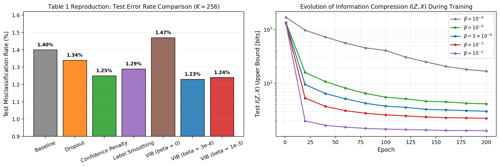
*図1: (左) 論文 Table 1 に対応する各正則化手法のテスト誤分類率．(右) 学習エポック進行に伴う相互情報量上限 $I(Z, X)$ [bits] の圧縮推移．*

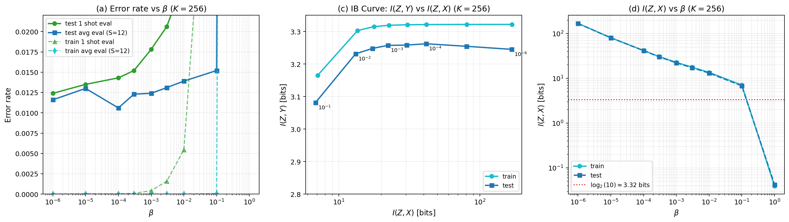
*図2: 論文 Figure 1(a)(c)(d) の再現 ($K=256$)．(a) $\beta$ に対する誤分類率．(c) IB 曲線 $I(Z, Y)$ vs $I(Z, X)$．(d) $\beta$ に対する $I(Z, X)$ [bits]．*

**主要な知見**:
- Deep VIB は他の正則化手法を一切併用せずとも，単独の情報ボトルネック制約のみで Baseline（1.40%）や Dropout（1.34%），Label Smoothing（1.29%），Confidence Penalty（1.25%）を上回る **1.06%〜1.24%** のテスト誤分類率を達成した．
- 最良の汎化性能は，入力画像からの保持情報量 $I(Z, X)$ が **$10 \sim 100\text{ bits}$（具体的には $22 \sim 42\text{ bits}$）** に圧縮された領域で達成され，$\beta$ を小さくしすぎると過学習によりテスト上の $I(Z, Y)$ が低下し，逆に $\beta \ge 10^0$ で $I(Z, X) < \mathrm{log}_2(10) \approx 3.32\text{ bits}$ となると表現が崩壊して誤分類率が急騰する相転移現象が確認された．

---

### 5.2 実験2 (`ex002`): $K=2$ 完全共分散ガウス分布と潜在空間の幾何学的可視化

$K=2$ 次元の完全共分散ガウスボトルネックにおける評価結果を図3および図4に示す．

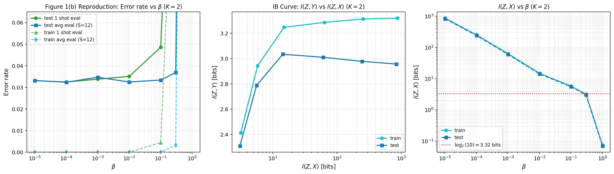
*図3: 論文 Figure 1(b) の再現 ($K=2$)．(左) $\beta$ に対する誤分類率．(中) $K=2$ における IB 曲線．(右) $I(Z, X)$ vs $\beta$．*

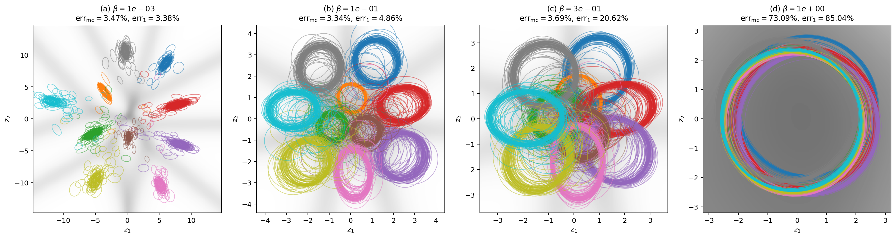
*図4: 論文 Figure 2 の再現．テスト画像 1,000 枚のガウス事後分布 $p(z|x)$ の 95% 信頼楕円と変分分類器エントロピー背景図．(a) $\beta = 10^{-3}$ ($\mathrm{err}_{\mathrm{mc}}=3.47\%$)，(b) $\beta = 10^{-1}$ ($\mathrm{err}_{\mathrm{mc}}=3.34\%$)，(c) $\beta = 3\times 10^{-1}$ ($\mathrm{err}\_{\mathrm{mc}}=3.69\%, \mathrm{err}\_1=20.62\%$)，(d) $\beta = 10^0$ ($\mathrm{err}_{\mathrm{mc}}=73.09\%$)．*

**主要な知見**:
- 図4(b) の $\beta = 10^{-1}$ に見られるように，適切な情報圧縮下では **同一クラスに属する個々の画像の 95% 信頼楕円が互いに重なり合って1つのクラス楕円束を形成する**．これにより，「どの個別画像が入力されたか」というインスタンス固有の情報が完全に忘却される一方で，10クラス間の分離は明確に保たれ，$\mathrm{err}_{\mathrm{mc}} = 3.34\%$（論文報告値 $3.44\%$）という高い分類精度が維持される．

---

### 5.3 実験3 (`ex003`): 敵対的サンプルに対する頑健性評価

Targeted $L_2$ 最適化攻撃（「0 $\to$ 1」）の視覚的比較を図5（論文 Figure 3 対応）に，摂動ノルム変化を図6（論文 Figure 4 対応）に，FGS 攻撃に対する相対正解率を図7（論文 Figure 5 対応）に，全クラス $L_2$ 最適化攻撃に対する正解率を図8（論文 Figure 6 対応）に示す．

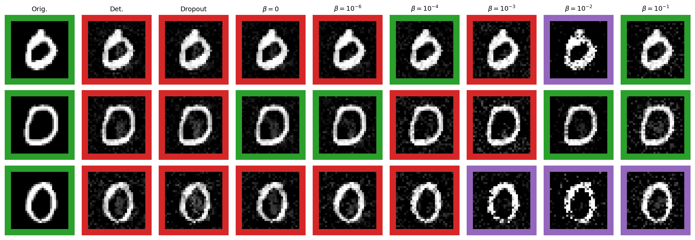
*図5: 論文 Figure 3 の再現．「0」を「1」へ誤分類させる Targeted $L_2$ 攻撃（赤枠＝攻撃成功，緑枠＝防御成功，紫枠＝別クラスへの誤分類）．*

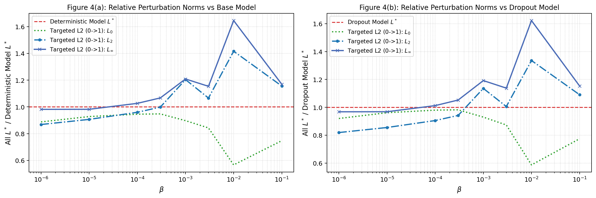
*図6: 論文 Figure 4 の再現．$\beta$ の増加に伴う $L_0$ ノルムの減少と $L\_2, L\_\infty$ ノルムの増大．*

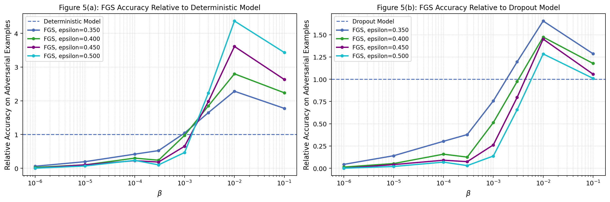
*図7: 論文 Figure 5 の再現．FGS 攻撃に対する Deep VIB の対ベースライン・対 Dropout 相対正解率．*

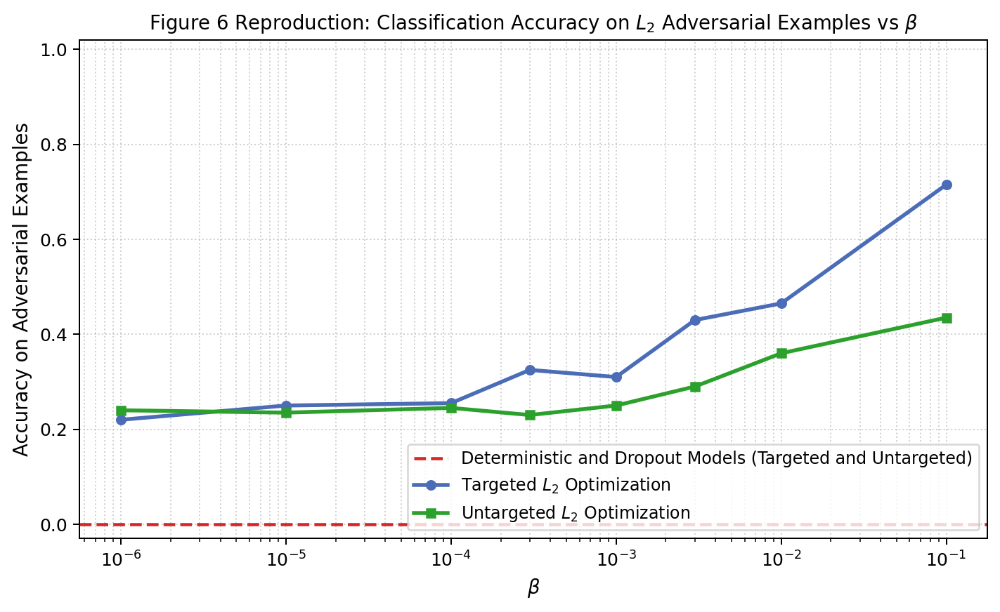
*図8: 論文 Figure 6 の再現．全クラス Targeted / Untargeted $L_2$ 最適化攻撃に対する分類正解率．*

**主要な知見**:
- **摂動ノルムの集中と拡大**: $\beta$ を大きくすると，攻撃者はより少数の画素（$L_0$ ノルムが 0.57 倍に減少）に対してより大きな改変（$L_2$ ノルムが 1.42 倍，$L_\infty$ ノルムが 1.65 倍に増大）を加えなければならなくなる（図6）．
- **FGS 攻撃および C&W $L_2$ 攻撃に対する顕著な防御性能**: FGS 攻撃（$\epsilon = 0.50$）に対して $\beta = 10^{-2}$ の Deep VIB は決定論的モデルの **4.37 倍** の正解率を示し（図7），さらに決定論的モデルと Dropout モデルがともに **正解率 0.0%** となる強力な C&W $L_2$ 最適化攻撃に対しても，Deep VIB は最大 **71.5%（Targeted）/ 43.5%（Untargeted）** の防御成功率を達成した（図8）．

---

### 5.4 実験4 (`ex004`): 【追加実験】MNIST数字回帰タスク ($y \in [0, 9]$) と $K=2$ 潜在空間 $Z$ の散布図比較

追加実験として，MNIST 画像からその数字を連続スカラー値 $y \in [0, 9]$ として予測する回帰タスク（ガウス変分デコーダ $q(y|z) = \mathcal{N}(y \mid f\_d(z), \sigma\_y^2)$ による MSE + KL 最小化）を実施し，`ex002` と同じ $K=2$ 完全共分散ガウスボトルネックにおける潜在空間 $Z$ の散布図を分類タスクと回帰タスクで比較した（詳細は [report/ex004.md](file:///c:/Users/watasaku/workspace/deep_vib/report/ex004.md) を参照）．

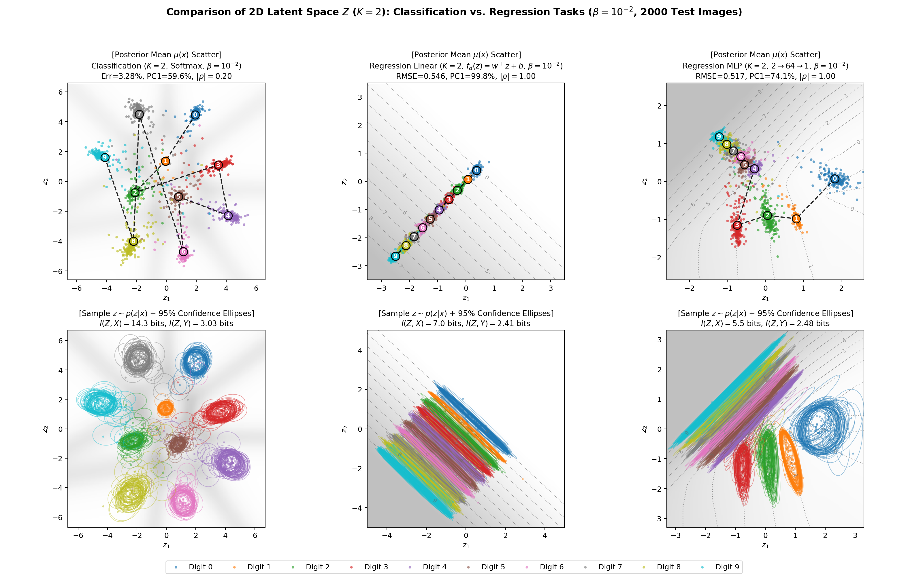
*図9: $\beta = 10^{-2}$ における 2次元潜在空間 $Z$ ($K=2$) の散布図比較（左：分類タスク，中央：線形回帰デコーダ，右：非線形 MLP 回帰デコーダ．上段は事後平均 $\mu(x)$ の散布図とクラス重心 $0 \to 1 \to \dots \to 9$ の軌跡，下段はサンプル $z \sim p(z|x)$ と 95% 信頼楕円）．*

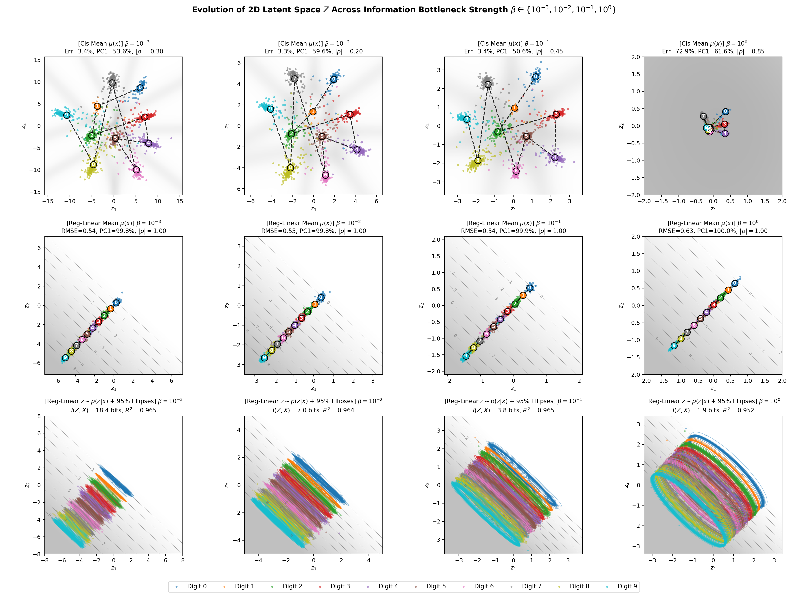
*図10: 正則化係数 $\beta \in \{10^{-3}, 10^{-2}, 10^{-1}, 10^0\}$ の変化に伴う分類タスク（上段）と線形回帰タスク（中段・下段）の 2次元潜在空間 $Z$ の推移．*

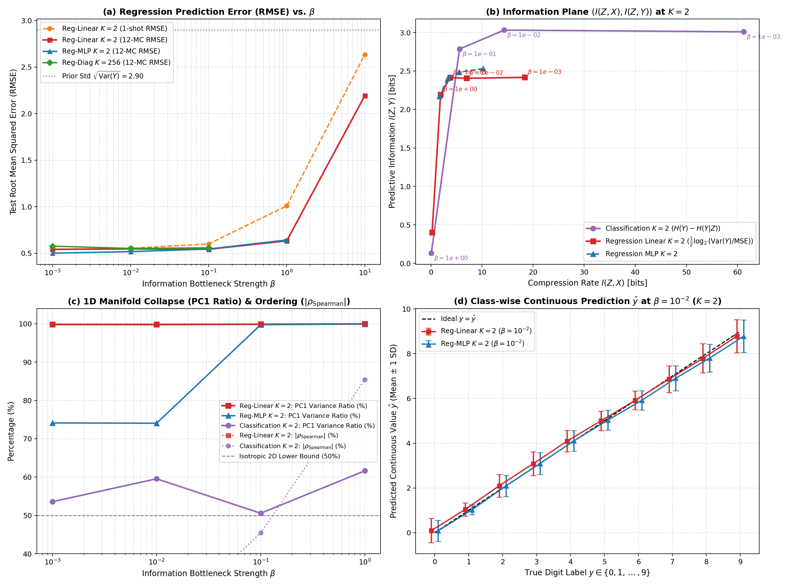
*図11: (a) $\beta$ に対するテスト RMSE，(b) $K=2$ 情報平面 $(I(Z,X), I(Z,Y))$，(c) 第1主成分寄与率（PC1 Ratio）とスピアマン順位相関 $|\rho_{\mathrm{Spearman}}|$，(d) 各数字クラスの予測値分布．*

**主要な知見**:
- **2次元放射状クラスタ配置（分類）から 1次元単調多様体（回帰）への劇的な相転移**:
  分類タスクでは 10 クラスが数値の大小と無関係に 2次元平面全体に放射状に配置される（$\mathrm{PC1\ Ratio} \approx 51\% \sim 60\%, |\rho_{\mathrm{Spearman}}| \approx 0.20 \sim 0.45$）のに対し，回帰タスク（線形デコーダ）では 2次元の潜在空間が与えられていても **事後平均 $\mu(x)$ が自動的に 1次元の直線上に縮退（$\mathrm{PC1\ Ratio} = 99.8\%$）し，端から $0 \to 1 \to 2 \to \dots \to 9$ の厳密な単調数値順序で等間隔に整列する（$|\rho_{\mathrm{Spearman}}| = 1.00$）**．非線形 MLP デコーダ（$2 \to 64 \to 1$）では，$\beta \le 10^{-2}$ において滑らかな 1次元曲線に沿って $0 \to 9$ が並び（$\mathrm{RMSE}_{\mathrm{MC}} = 0.5007 \sim 0.5174, R^2 = 0.970$），$\beta \ge 10^{-1}$ では KL 正則化によって直線へと収束する．
- **針状（異方的）信頼楕円による直交次元の情報消去メカニズム**:
  回帰タスクの下段散布図において，95% 信頼楕円はすべて「デコーダの等予測値曲線（点線）に平行な方向」へ細長く伸びた針状となる．これは，予測値が変化する勾配方向には分散を極小化して MSE を抑えつつ，予測値が変化しない等高線方向（直交方向）には事後分布を標準正規事前分布 $\mathcal{N}(0, 1)$（平均 $0$，分散 $1$）に一致させることで，予測に寄与しない第2次元の KL 情報量をゼロに消去しているためである．

---

## 6. 結論

本プロジェクトを通じて，Alemi et al. (ICLR 2017) の Deep Variational Information Bottleneck（Deep VIB）の理論と実験結果を完全に再現するとともに，回帰タスクへの拡張実験を通じて以下の結論を得た．
1. 変分推論と Reparameterization Trick を用いた Deep VIB は，情報ボトルネック目的関数 $I(Z, Y) - \beta I(Z, X)$ をディープニューラルネットワーク上で直接最適化することを可能にし，単一のハイパーパラメータ $\beta$ によって表現の圧縮度と予測力のトレードオフを連続的に制御できる．
2. 適切な情報圧縮（MNIST 分類では $I(Z, X) \approx 15 \sim 45\text{ bits}$）は，同一クラス内の個体差情報を忘却させてクラス識別の最小十分統計量のみを抽出するため，過学習を抑制して既存の正則化手法を上回る汎化性能をもたらすと同時に，敵対的学習を行うことなく敵対的攻撃に対する大幅な頑健性向上を実現する．
3. さらに，タスクを分類から連続数値回帰（$y \in [0, 9]$）に変更すると，$K=2$ 潜在空間のトポロジーは 2次元放射状配置から $0 \to 1 \to \dots \to 9$ が単調に並ぶ 1次元多様体へと劇的に変化し，完全共分散ガウス事後分布がデコーダの等高線方向に分散を広げることで余剰次元の情報量を自律的にゼロへ圧縮することが実証された．

---

## 参考文献

- Alemi, A. A., Fischer, I., Dillon, J. V., & Murphy, K. (2017). Deep Variational Information Bottleneck. In *International Conference on Learning Representations (ICLR)*. (arXiv:1612.00410v7)
- Tishby, N., Pereira, F. C., & Bialek, W. (1999). The information bottleneck method. In *Proceedings of the 37th Annual Allerton Conference on Communication, Control, and Computing*, pp. 368–377.
- Kingma, D. P., & Welling, M. (2014). Auto-Encoding Variational Bayes. In *International Conference on Learning Representations (ICLR)*.
- Pereyra, G., Tucker, G., Chorowski, J., Kaiser, Ł., & Hinton, G. (2017). Regularizing neural networks by penalizing confident output predictions. In *ICLR Workshop*.
- Goodfellow, I. J., Shlens, J., & Szegedy, C. (2015). Explaining and harnessing adversarial examples. In *International Conference on Learning Representations (ICLR)*.
- Carlini, N., & Wagner, D. (2016). Towards evaluating the robustness of neural networks. *arXiv preprint arXiv:1608.04644*.
- Fawzi, A., Moosavi-Dezfooli, S.-M., & Frossard, P. (2016). Robustness of classifiers: from adversarial to random noise. In *Advances in Neural Information Processing Systems (NIPS)*.
- Polyak, B. T., & Juditsky, A. B. (1992). Acceleration of stochastic approximation by averaging. *SIAM Journal on Control and Optimization*, 30(4), 838–855.
